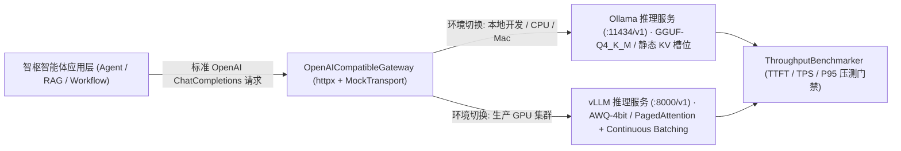

# Day 55 需求文档（PRD）、架构设计与 GitLab 协作记录

## 1. 旁白：本地私有化推理服务上线（Ollama vs vLLM 与 OpenAI 兼容网关）

> **🎙️ 讲师旁白**：欢迎来到《智枢企业级智能体平台》第五阶段（微调与私有化部署）——**Day 55**！昨天我们完成了 LoRA 权重合并与 GPTQ / AWQ / GGUF 模型量化，手里已经有了可以放进单卡 24GB 显存或企业内网 CPU 的模型产物。然而，**“模型能跑起来”和“服务能扛住 30 个部门并发调用”完全是两码事**！今天，DevOps 工程师赵磊正式发起 **Issue #055（`v0.5.0-day55`）**：要求在智枢平台中落地 **OpenAI 协议兼容推理网关（`OpenAICompatibleGateway`）**，支持在开发期 **Ollama** 与生产期 **vLLM** 之间零代码切换，并构建 **并发吞吐压测基准（`ThroughputBenchmarker`）**，用 TTFT、TPS 与 P95 延迟数据为私有化上线提供硬件与引擎决策依据！

---

## 2. GitLab Issue #055：私有化推理服务上线与并发压测

- **提出人**：DevOps 工程师 赵磊
- **指派给**：AI 应用开发工程师 陈默
- **关联分支**：`feature/day-55-local-inference-gateway-benchmark`
- **目标版本**：`v0.5.0-day55`

### 2.1 业务与技术需求描述
1. **统一后端配置抽象（`InferenceBackendConfig`）**：
   - 标准化描述 `ollama` 与 `vllm` 两类私有化推理引擎的接入地址（`/v1/chat/completions`、`/v1/models`）、默认模型名、最大并发槽位（`max_concurrency`）、KV Cache 策略（Static Contiguous KV vs PagedAttention）及 Continuous Batching 能力标识。
2. **OpenAI 兼容推理网关（`OpenAICompatibleGateway`）**：
   - 基于 `httpx.Client` 实现标准 `/v1/chat/completions` 与 `/v1/models` 调用，并内置 `httpx.MockTransport` 离线仿真支持，确保 CI/CD 流水线与教学环境无需启动真实 GPU 进程即可完成全链路集成验证。
   - 提供 `switch_backend()` 热切换能力：上层智能体业务代码无需修改任何提示词或调用逻辑，仅替换 `InferenceBackendConfig` 即可从本地 Ollama 平滑迁移至生产级 vLLM 集群。
3. **吞吐量与延迟压测基准（`ThroughputBenchmarker`）**：
   - 支持多线程并发压测真实网关，输出 **TTFT（Time To First Token，首字延迟）**、**系统总吞吐（System TPS，tokens/s）**、**平均延迟与 P95 延迟**。
   - 提供 `simulate_concurrency_comparison()` 仿真模型，量化对比 Ollama（`OLLAMA_NUM_PARALLEL` 槽位排队）与 vLLM（**Continuous Batching + PagedAttention**）在 `1 / 4 / 8 / 16 / 32` 并发下的扩展性差异。

---

### 2.2 私有化推理网关与双引擎切换架构

> **💡 架构师笔记（为什么生产并发必须上 vLLM？）**：
> - **Ollama（基于 llama.cpp）** 极度适合个人开发机、Mac Apple Silicon 或低并发内网工具，部署只需一条命令；但在高并发场景下受限于静态 KV Cache 预分配与固定并行槽位（`OLLAMA_NUM_PARALLEL`），超出槽位的请求会被阻塞排队，导致 **TTFT 急剧飙升**。
> - **vLLM** 通过 **PagedAttention** 将 KV Cache 像操作系统虚拟内存分页一样按 Block 动态分配（显存碎片接近 0%），并配合 **Continuous Batching（迭代级连续批处理）**——每生成一个 Token 即可动态踢出已完成的请求、插队接入新请求，在高并发下总吞吐（TPS）可达到 Ollama 的 **5x ~ 10x+**。

---

## 3. GitLab Merge Request !055 评审记录

- **提交说明**：`feat(day-55): 实现 OpenAI 兼容推理网关与 Ollama/vLLM 并发吞吐压测基准 (v0.5.0-day55)`
- **Tech Lead 张工 Review 意见**：
  - `[通过]` `InferenceBackendConfig` 对 `backend_type`、`base_url`、`max_concurrency` 做了严格入参校验，并提供了 `ollama_default()` 与 `vllm_default()` 工厂方法，避免配置拼写错误流入生产。
  - `[通过]` `OpenAICompatibleGateway` 利用 `httpx.MockTransport` 实现零网络依赖的协议级离线回放，同时保留标准 `httpx.Client` 传输层注入能力，生产环境只需传入 `use_mock=False` 即可直连真实 Ollama / vLLM 端口。
- **DevOps 赵磊 & QA 李婷 验收结果**：
  - `pytest project_iterations/day_55/tests -v` 全部单元测试 100% PASS。
  - `verify_day.py` Notebook 执行与单元测试双校验通过，准予合并至 `main` 并打标 `v0.5.0-day55`。
