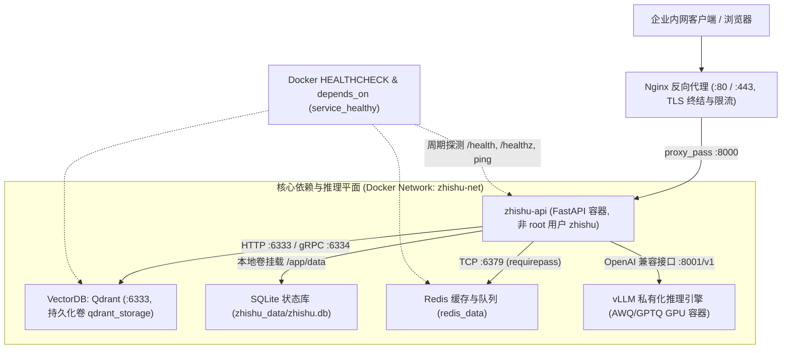

# Day 56 需求文档（PRD）、架构设计与 GitLab 协作记录

## 1. 旁白：全栈容器化部署工程（Dockerfile、Docker Compose 与健康检查）

> **🎙️ 讲师旁白**：欢迎来到《智枢企业级智能体平台》第五阶段（微调与私有化部署）——**Day 56**！前面我们完成了私域微调、LoRA 合并与 4-bit 量化，也在单机上跑通了推理服务。但到了企业客户内网交付现场，“在我电脑上能跑”是最危险的幻觉：Python 版本不一致、依赖库冲突、容器以 `root` 运行触发安全红线、数据库还没启动完 API 就崩溃重启……今天，运维负责人（DevOps）**赵磊**下发 **GitLab Issue #056（`v0.5.0-day56`）**，要求完成 **Docker Compose 全栈容器化上线**，并配套自动化打包校验器 `deployment_packager.py`，在 CI/CD 阶段就把镜像体积、非 root 权限、健康检查与密钥安全一次锁死！

---

## 2. GitLab Issue #056：Docker Compose 全栈容器化上线

- **提出人**：DevOps 工程师 赵磊
- **指派给**：AI 应用开发工程师 陈默
- **关联分支**：`feature/day-56-containerized-deployment`
- **目标版本**：`v0.5.0-day56`

### 2.1 业务与工程验收标准
1. **生产级多阶段 Dockerfile（`Dockerfile`）**：
   - 采用 `python:3.11-slim` 多阶段构建（`builder` 阶段隔离编译与 venv 安装，`runtime` 阶段仅拷贝 `/opt/venv` 与业务代码），大幅缩减镜像体积与攻击面。
   - 必须创建并切换为最小权限非 root 用户（`USER zhishu`，UID/GID `10001`）。
   - 显式声明 `EXPOSE 8000` 并配置内置 `HEALTHCHECK`，探测 FastAPI `/health` 接口。
2. **全栈服务编排（`docker-compose.yml`）**：
   - 统一编排 `zhishu-api`（FastAPI 智能体网关）、`qdrant`（向量数据库）与 `redis`（缓存与异步队列）。
   - 配置持久化命名卷（`zhishu_data`、`zhishu_logs`、`qdrant_storage`、`redis_data`），确保容器重建后知识库向量与 SQLite 业务数据不丢失。
   - 使用 `depends_on` + `condition: service_healthy` 确保依赖服务就绪后再拉起应用。
3. **环境变量隔离与安全基线（`.env.example` & `deployment_packager.py`）**：
   - 提供 `.env.example` 模板，所有真实密钥均通过 `.env` 注入，严禁硬编码在 `Dockerfile`、`docker-compose.yml` 或 Git 仓库中。
   - 实现 `validate_dockerfile`、`validate_compose_yaml_structure` 与 `check_env_secrets_safety`，作为 CI/CD 上线前强制门禁。

---

### 2.2 全栈容器化部署拓扑架构

> **💡 架构师笔记（为什么生产环境必须同时具备 `HEALTHCHECK` 与 `condition: service_healthy`？）**：
> Docker 默认的 `depends_on`（不带 `condition`）只保证“容器进程已启动”，并不保证 Qdrant HTTP 端口或 Redis 认证就绪。如果 `zhishu-api` 在数据库初始化期间就发起连接，会直接抛出 `ConnectionRefusedError` 并陷入 CrashLoop。配合各服务的 `healthcheck` 与 `condition: service_healthy`，编排引擎会精确等待底层存储就绪后再启动应用层。

---

## 3. GitLab Merge Request !056 评审记录

- **提交说明**：`feat(day-56): 完成智枢平台多阶段 Dockerfile、Docker Compose 全栈编排与部署合规校验器 (v0.5.0-day56)`
- **DevOps 赵磊 Review 意见**：
  - `[通过]` `Dockerfile` 采用 `builder` + `runtime` 两阶段构建，最终镜像基于 `python:3.11-slim` 且切换至 `USER zhishu`（UID 10001），符合企业容器安全基线（CIS Docker Benchmark）。
  - `[通过]` `docker-compose.yml` 为 `qdrant`、`redis`、`zhishu-api` 均配置了独立 `healthcheck` 与持久化命名卷，`zhishu-api` 正确声明了 `service_healthy` 启动依赖。
  - `[通过]` `deployment_packager.py` 无需外部 PyYAML 即可完成结构化缩进、服务完整性和密钥泄漏扫描，适合直接集成进轻量级 GitLab Runner CI 流水线。
- **QA 李婷 测试结果**：
  - `.venv/bin/python -m pytest project_iterations/day_56/tests -v` 全部 7 项单元测试 100% PASS。
  - `verify_day.py` Notebook 执行与单元测试双校验通过，准予合并至 `main` 并打标 `v0.5.0-day56`。
