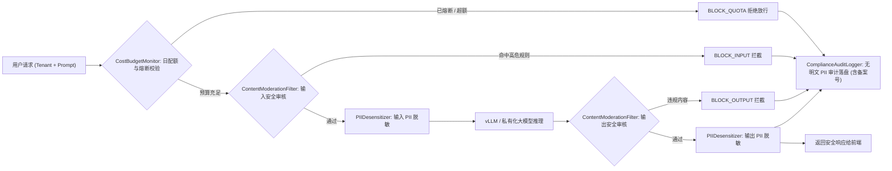

# Day 57 需求文档（PRD）、架构设计与 GitLab 协作记录

## 1. 旁白：Week 9 综合测验与企业级大模型安全合规网关

> **🎙️ 讲师旁白**：欢迎来到《智枢企业级智能体平台》第五阶段（微调与私有化部署）——**Day 57（第九周收官日）**！在过去一周里，我们完成了从微调原理（LoRA/QLoRA）、SFT 数据集清洗、LLaMA-Factory 实战配置、权重合并与量化（GPTQ/AWQ/GGUF）、vLLM 高并发推理到 Docker Compose 一键编排的全链路工程实践。但在企业真正开放内网或公网服务前，安全法务与财务团队提出了最后一道铁律：**模型能力再强，若发生提示词注入、PII 明文泄露、未备案违规输出或 Token 预算失控，系统一律不准上线！** 今天，Tech Lead 张工下发 **Issue #057（`v0.5.0-day57`）**，要求构建 **LLM 安全与合规网关（Compliance Gateway）**，并完成 **Week 9 综合能力评估测验**。

---

## 2. GitLab Issue #057：LLM 安全、隐私脱敏、备案合规与成本熔断网关

- **提出人**：安全合规官 周敏 / Tech Lead 张工
- **指派给**：AI 应用开发工程师 陈默
- **关联分支**：`feature/day-57-compliance-gateway`
- **目标版本**：`v0.5.0-day57`

### 2.1 业务与技术需求描述
1. **输入/输出内容安全过滤（`ContentModerationFilter`）**：
   - 在请求进入 vLLM 之前校验 `check_input()`，在模型响应返回用户之前校验 `check_output()`。
   - 支持多风险类别（`PROMPT_INJECTION` 提示词注入、`ILLEGAL_CYBER` 网络攻击、`DATA_EXFILTRATION` 数据窃取、`VIOLENCE_HARM` 暴力危害等）与自定义企业敏感词库扩展，输出风险等级（`LOW` / `MEDIUM` / `HIGH`）与命中明细。
2. **PII 敏感信息自动脱敏（`PIIDesensitizer`）**：
   - 自动识别并脱敏中国大陆 **18 位身份证号**（保留前 6 后 4）、**16~19 位银行卡号**（保留前 4 后 4）、**11 位手机号**（保留前 3 后 4）与 **电子邮箱**（隐藏用户名主体）。
   - 严格控制正则匹配顺序与数字边界（`(?<!\d)...(?!\d)`），防止身份证号与银行卡号、手机号之间发生误匹配冲突。
3. **租户级成本配额与硬熔断器（`CostBudgetMonitor`）**：
   - 按租户与自然日统计输入/输出 Token 消耗成本（CNY），支持差异化租户日预算配置（`set_tenant_quota`）。
   - 当租户当日累计消费达到或超过预算上限时，立即触发 **硬熔断器（Circuit Breaker）**，后续请求在网关层直接拦截（`BLOCK_QUOTA`），防止刷接口导致账单爆炸。
4. **备案合规与无明文 PII 审计日志（`ComplianceAuditLogger`）**：
   - 对照《生成式人工智能服务管理暂行办法》及企业算法备案要求，每条审计记录绑定备案号（`filing_record_id`）、请求时间、租户 ID、处置动作（`ALLOW` / `BLOCK_INPUT` / `BLOCK_OUTPUT` / `BLOCK_QUOTA`）与输入原文 SHA-256 摘要。
   - **安全铁律**：落盘日志（JSONL）与内存预览仅允许保留二次强制脱敏后的文本片段，严禁存储任何明文 PII。

---

### 2.2 安全与合规网关流水线架构

> **💡 合规架构师笔记（备案与日志留存边界）**：
> 根据我国《生成式人工智能服务管理暂行办法》及双备案（算法备案 + 大模型上线备案）要求，企业对外或面向特定行业提供生成式 AI 服务时，需具备**安全评估与人工抽检日志能力**；同时依据《个人信息保护法》，审计日志不得明文留存用户身份证、银行卡、手机号等敏感个人信息。因此采用 **“原始输入 SHA-256 摘要 + 脱敏后文本预览 + 备案编号”** 的组合，既满足安全追溯与监管核验，又守住隐私保护底线。

---

## 3. GitLab Merge Request !057 评审记录

- **提交说明**：`feat(day-57): 实现大模型内容安全过滤、PII 脱敏、成本熔断与无明文审计网关 (v0.5.0-day57)`
- **Tech Lead 张工 Review 意见**：
  - `[通过]` `PIIDesensitizer` 按 `18位身份证 -> 16-19位银行卡 -> 11位手机号 -> 邮箱` 顺序匹配并加了 `(?<!\d)...(?!\d)` 边界断言，实测混合文本零误伤。
  - `[通过]` `ComplianceAuditLogger.log_event` 内部强制调用 `PIIDesensitizer`，即使上游业务代码误传未脱敏文本，也不会将明文 PII 写入 JSONL 审计文件。
  - `[通过]` `CostBudgetMonitor` 实现日维度配额隔离与硬熔断器，超额后 `check_budget` 在推理前即快速失败（Fail-Fast），零无效 GPU 算力浪费。
- **QA 李婷 测试结果**：
  - `pytest project_iterations/day_57/tests -v` 全部 5 组核心测试 100% PASS。
  - `verify_day.py` Notebook 执行与单元测试双校验通过，准予合并至 `main` 并打标 `v0.5.0-day57`。
