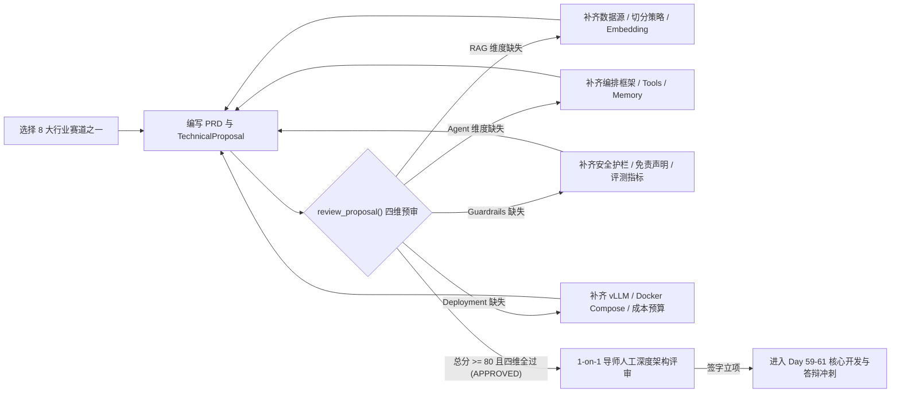

# Day 58 需求文档（PRD）、架构设计与 GitLab 协作记录

## 1. 旁白：Stage 6 毕业实战与求职冲刺开启——开题选题与 1-on-1 架构评审

> **🎙️ 讲师旁白**：欢迎来到《智枢企业级智能体平台》第六阶段（**Stage 6：企业级毕业项目实战与就业指导**）的开篇之日——**Day 58（v1.0.0-day58）**！
> 在前五个阶段中，我们已经系统掌握了 Python 工程基础、LLM API 与 FastAPI 后端、LangChain & RAG 检索增强、LangGraph 多智能体编排、以及微调量化与 vLLM/Docker 安全合规部署。从今天起，学员将正式从“跟随模块化练手”迈向“独立主导端到端企业级 AI Agent 产品交付”。
> 为避免毕业项目陷入“只有 Demo、没有护栏、无法上线”的常见陷阱，Tech Lead 张工今日下发 **GitLab Issue #058**，正式发布 **8 大行业毕业赛道**，并要求搭建 **开题 PRD 与技术方案自动化预审器（`capstone_planner.py`）**，在 1-on-1 架构评审前自动校验 **RAG / Agent / Guardrails / Deployment** 四大维度的工程完整性。

---

## 2. GitLab Issue #058：毕业项目开题立项与 1-on-1 技术方案评审

- **提出人**：Tech Lead 张工 / 教学总监 林老师
- **指派给**：AI 应用开发工程师 陈默
- **关联分支**：`feature/day-58-capstone-kickoff`
- **目标版本**：`v1.0.0-day58`

### 2.1 业务与技术需求描述
1. **8 大标准行业赛道目录（`CAPSTONE_TOPICS`）**：
   - 覆盖课程大纲规定的全部 8 个高价值落地方向：**法律咨询助手**、**简历优化Agent**、**电商智能客服**、**论文阅读助手**、**旅行规划Agent**、**企业财报分析系统**、**教育答疑系统**、**医疗健康科普助手**。
   - 每个赛道必须明确定义 `core_scenarios`（核心场景）、`recommended_rag`（推荐检索架构）、`recommended_tools`（核心工具清单）、`key_guardrails`（行业安全红线）与 `evaluation_metrics`（量化验收指标）。
2. **结构化开题提案模型（`TechnicalProposal`）**：
   - 基于 Pydantic v2 构建，统一收敛业务痛点（`problem_statement`、`target_users`）与四大技术工程维度（RAG、Agent、Guardrails、Deployment）。
3. **四维自动化评审引擎（`review_proposal`）**：
   - 对每份提案按 **RAG (25 分) + Agent (25 分) + Guardrails (25 分) + Deployment (25 分) = 100 分** 进行量化打分。
   - 产出 `APPROVED`（四维均通过且总分 >= 80）、`NEEDS_REVISION`（50~79 分或存在缺失维度）或 `REJECTED`（< 50 分）三态结论，并附带精确到字段的 `blocking_issues` 与行业定制 `suggestions`。

---

### 2.2 开题立项与 1-on-1 架构评审流水线

> **💡 Tech Lead 架构师笔记（为什么开题必须先过四维预审？）**：
> 在真实企业立项（Design Doc Review）中，80% 的返工源自前期遗漏非功能性需求——例如做“医疗健康科普助手”却未设计红旗症状急诊提示与免责声明，或做“企业财报分析系统”却让 LLM 直接心算财务比率而未挂载 Python 计算工具，或未设置租户日成本上限导致上线即超支。通过 `review_proposal()` 将“四维工程底线”代码化，能确保每一位学员在 Day 59 动手写业务代码前就拥有一份生产级蓝图。

---

## 3. GitLab Merge Request !058 评审记录

- **提交说明**：`feat(day-58): 发布 8 大行业毕业赛道与开题技术方案四维评审器 (v1.0.0-day58)`
- **Tech Lead 张工 Review 意见**：
  - `[通过]` `CAPSTONE_TOPICS` 完整覆盖 8 大行业赛道，支持中文名称与 `topic_id` 双向检索，且每个赛道均绑定了行业专属合规护栏（如金融非投资建议、医疗非诊断红线、教育启发式引导）。
  - `[通过]` `TechnicalProposal` 对未填字段采用安全的默认值，确保残缺草案也能顺利进入 `review_proposal()` 并获得清晰的字段级阻塞提示，而不是在反序列化阶段直接崩溃。
  - `[通过]` 评审器严格执行“四维全过 + 总分 >= 80”才给予 `APPROVED`，杜绝“某一项 0 分靠其他项拉高总分蒙混过关”的短板效应。
- **QA 李婷 测试结果**：
  - `pytest project_iterations/day_58/tests -v` 全部 12 组测试用例（含 8 大赛道参数化全通过验证）100% PASS。
  - `verify_day.py` Notebook 执行与单元测试双校验通过，准予合并至 `main` 并打标 `v1.0.0-day58`。
