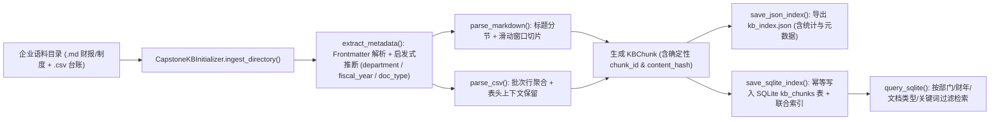

# Day 59 需求文档（PRD）、架构设计与 GitLab 协作记录

## 1. 旁白：第六阶段 Capstone 实战启航（Dev Day 1）

> **🎙️ 讲师旁白**：欢迎来到《智枢企业级智能体平台》第六阶段（企业级综合实战与求职冲刺）——**Day 59（Capstone 开发第 1 天）**！前五个阶段我们已经逐一攻克了 Python 工程基础、LLM API、LangChain + RAG、多智能体协同（LangGraph/MCP）以及微调量化与安全合规网关。从今天起，Tech Lead 张工正式下发 **Capstone 毕业级项目——“智枢企业财务与合规智能体平台（`v1.0.0-day59`）”**。所有功能都必须从零搭建在可独立部署的工程骨架中。今天作为 **Day 1**，我们首先打通整个智能体系统的“记忆底座”：**项目工程骨架搭建** 与 **企业财务/合规知识库初始化流水线（`CapstoneKBInitializer`）**。

---

## 2. GitLab Issue #059：Capstone 项目骨架与财务合规知识库初始化

- **提出人**：财务合规产品经理 林晓 / Tech Lead 张工
- **指派给**：AI 应用开发工程师 陈默
- **关联分支**：`feature/day-59-capstone-kb-init`
- **目标版本**：`v1.0.0-day59`

### 2.1 业务与技术需求描述
1. **Capstone 独立工程骨架（`project_iterations/day_59`）**：
   - 建立标准化的包结构 `zhishu_agent/`、`main.py` 演示入口与 `tests/` 自动化测试目录，确保后续 Day 60~62（混合检索、工具编排、合规网关集成、FastAPI/Docker 交付）平滑演进。
2. **多格式企业语料解析（`.md` / `.csv`）**：
   - 支持解析带 YAML Frontmatter 与多级标题（`#` ~ `####`）的 **企业财务报告 / 合规制度 Markdown 文档**，按语义章节与滑动窗口（`chunk_size` + `chunk_overlap`）切分。
   - 支持解析结构化 **财务预算与费用台账 CSV 文件**，通过 `rows_per_csv_chunk` 聚合成可读文本块，避免单行孤立切分丢失表头上下文。
3. **强制结构化元数据注入**：
   - 每个 `KBChunk` 必须携带 `department`（部门）、`fiscal_year`（财年，如 `FY2025` / `FY2026`）、`doc_type`（文档类型，如 `financial_report` / `compliance_policy` / `financial_ledger`）、`source_file` 与 `section_heading`。
   - 支持 **Frontmatter 显式声明 + 文件名/正文启发式自动推断** 双重机制。
4. **JSON + SQLite 双路持久化与幂等更新**：
   - 导出全量 `kb_index.json`（含 `version`、`stats` 统计与 `chunks` 数组），便于人工审计与向量化前预览。
   - 持久化至 `kb_index.sqlite`（`kb_chunks` 表 + `(department, fiscal_year, doc_type)` 联合索引），采用确定性 `chunk_id` 与 `INSERT OR REPLACE` 保证重复构建 100% 幂等，并提供 `query_sqlite()` 支持按元数据与关键词快速检索。

---

### 2.2 Capstone Day 1 知识库构建流水线架构

> **💡 架构师笔记（为什么先落 JSON + SQLite 再接向量库？）**：
> 在企业级 RAG 工程中，直接把原始文档灌入向量数据库往往会导致“切片边界错乱、元数据缺失、无法按财年或部门精确过滤、排查召回问题困难”。通过 Day 1 先建立 **确定性切片 + 结构化元数据 + SQLite 索引 + JSON 审计快照** 的中间层，团队可以在离线阶段低成本验证切片质量与过滤精度，后续（Day 60）只需读取 `kb_chunks` 即可一键生成 Embedding 写入 Qdrant/Milvus，实现存储与检索解耦。

---

## 3. GitLab Merge Request !059 评审记录

- **提交说明**：`feat(day-59): 搭建 Capstone 项目骨架并实现财务合规知识库初始化与 JSON/SQLite 持久化 (v1.0.0-day59)`
- **Tech Lead 张工 Review 意见**：
  - `[通过]` `extract_metadata` 优先匹配文件名关键词再回退正文，避免了财务台账 CSV 因某一行包含 `compliance` 部门字段而被误判为合规文档的问题。
  - `[通过]` `chunk_id` 基于 `source_file + chunk_index + content_hash` 生成确定性 SHA-256 前缀，配合 SQLite `INSERT OR REPLACE` 实现完全幂等的增量/全量重建。
  - `[通过]` `query_sqlite` 全部使用参数化 SQL（`?` 占位符），杜绝 SQL 注入隐患，且建立了 `(department, fiscal_year, doc_type)` 复合索引。
- **QA 李婷 测试结果**：
  - `pytest project_iterations/day_59/tests -v`（使用 `tmp_path` 隔离测试目录）4 组核心用例 100% PASS。
  - `verify_day.py` Notebook 执行与单元测试双校验通过，准予合并至 `main` 并打标 `v1.0.0-day59`。
