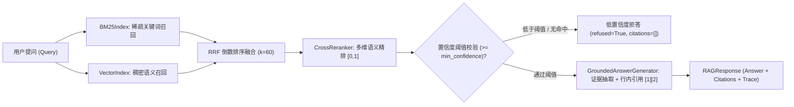

# Day 60 需求文档（PRD）、架构设计与 GitLab 协作记录

## 1. 旁白：毕业设计开发 Day 2 — 核心混合检索与可溯源引用 RAG 主链路

> **🎙️ 讲师旁白**：欢迎来到《智枢企业级智能体平台》第六阶段（毕业设计与就业冲刺）——**Day 60（Capstone Dev Day 2）**！在 Day 59 完成毕业设计选题立项、数据契约与工程骨架搭建后，今天正式进入核心引擎开发阶段。企业真实场景对知识库问答有两条不可妥协的底线：**第一，既要查得准（精确错误码/制度条款不漏召回，语义问法能泛化）；第二，绝不胡说八道（每条结论必须附带 `[1]`、`[2]` 行内可溯源引用，证据不足时必须触发低置信度拒答）。** 今天，Tech Lead 张工下发 **Issue #060（`v1.0.0-day60`）**，要求完成 `CapstoneRAGEngine` 主链路交付。

---

## 2. GitLab Issue #060：核心混合 RAG + 行内引用与防幻觉拒答主链路

- **提出人**：产品经理 林晓 / Tech Lead 张工
- **指派给**：AI 应用开发工程师 陈默
- **关联分支**：`feature/day-60-capstone-hybrid-rag`
- **目标版本**：`v1.0.0-day60`

### 2.1 业务与技术需求描述
1. **双路混合召回（`BM25Index` + `VectorIndex`）**：
   - **稀疏检索（`BM25Index`）**：基于中英文混合分词（英文/错误码词元 + 中文 Unigram/Bigram）与 Okapi BM25 算法，确保 `ERR_502`、`5000 元`、`15 个工作日` 等精确关键词零漏召。
   - **稠密检索（`VectorIndex` + `DeterministicEmbedder`）**：基于 Feature Hashing + L2 归一化向量与余弦相似度，提升同义表述与长句语义召回能力。
2. **倒数排序融合与精排（`reciprocal_rank_fusion` + `CrossReranker`）**：
   - 采用 RRF 公式 $\text{score}(d) = \sum_{r} \frac{w_r}{k + \text{rank}_r(d)}$（默认 $k=60$）消除 BM25 与余弦相似度的量纲差异。
   - `CrossReranker` 综合查询词元覆盖率、多字词/术语精确命中、标题命中与 RRF 先验，输出 `[0.0, 1.0]` 区间的归一化精排置信度 `rerank_score`。
3. **行内可溯源引用生成（`GroundedAnswerGenerator`）**：
   - 为每条采纳的知识切片分配 1-indexed 引用编号 `[1]`、`[2]`，提取最相关证据句并在正文句末插入行内标记，同时返回结构化 `Citation` 列表（含 `chunk_id`、`source`、`section`、`snippet`、`relevance_score`）。
4. **低置信度拒答机制（Low-Confidence Refusal）**：
   - 当未召回候选切片、或最高 `rerank_score < min_confidence`（默认 `0.22`）时，自动拦截生成流程，返回 `refused=True`、`citations=[]` 与明确的 `refusal_reason`，杜绝无依据幻觉回答。

---

### 2.2 核心混合 RAG + 引用主链路架构

> **💡 架构师笔记（为什么 RRF + 归一化精排比直接加权分数更稳健？）**：
> BM25 得分无固定上界（常见 `2.0 ~ 25.0`），而余弦相似度位于 `[-1, 1]`，直接线性加权极易被单一通路主导；RRF 仅依赖排名位置即可实现无参平滑融合。随后再由 `CrossReranker` 将候选压缩到统一的 `[0, 1]` 置信度标尺上，使得 `min_confidence` 拒答阈值在不同语料规模下依然保持可解释与可调优。

---

## 3. GitLab Merge Request !060 评审记录

- **提交说明**：`feat(day-60): 实现 CapstoneRAGEngine 混合检索、RRF 重排、行内引用与低置信度拒答主链路 (v1.0.0-day60)`
- **Tech Lead 张工 Review 意见**：
  - `[通过]` `CapstoneRAGEngine` 对 `BM25Index`、`VectorIndex`、`CrossReranker` 与 `GroundedAnswerGenerator` 职责解耦清晰，全部使用纯标准库实现确定性索引，CI 零外部依赖即可秒级回归。
  - `[通过]` `GroundedAnswerGenerator` 保证正文中的 `[i]` 标记与 `citations` 列表严格一一对应，且 `RAGResponse.to_dict()` 可直接对接后续 FastAPI 路由。
  - `[通过]` 空查询与域外问题均能稳定触发 `refused=True` 且 `citations=[]`，防幻觉边界清晰。
- **QA 李婷 测试结果**：
  - `pytest project_iterations/day_60/tests -v` 全部 5 组核心单元测试 100% PASS。
  - `verify_day.py` Notebook 执行与单元测试双校验通过，准予合并至 `main` 并打标 `v1.0.0-day60`。
