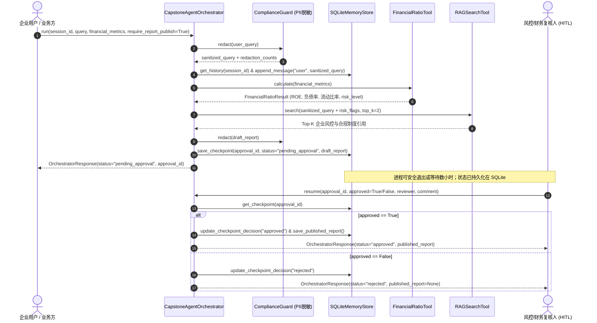

# Day 61 需求文档（PRD）、架构设计与 GitLab 协作记录

## 1. 旁白：毕业设计开发日 3 —— 多工具协同、持久化记忆与 HITL 人工审批

> **🎙️ 讲师旁白**：欢迎来到《智枢企业级智能体平台》第六阶段（毕业设计与就业冲刺）——**Day 61（Capstone Dev Day 3）**！在前面完成了基础脚手架与单点能力打磨后，今天我们要把“玩具级 Demo”真正升级为**可交付、可审计、可断点恢复的生产级企业智能体**。产品经理（PM）**林晓**联合技术负责人（Tech Lead）**张工**下发 **GitLab Issue #061（`v1.0.0-day61`）**：要求在 `CapstoneAgentOrchestrator` 中打通 **财务比率计算工具 + 企业风控 RAG 检索工具 + SQLite 多轮持久化记忆 + PII 合规脱敏网关 + 高管风险报告发布前 HITL（Human-in-the-Loop）中断与恢复机制**。任何高风险报告在正式对外发布前，必须落盘检查点并交由风控/财务负责人人工复核签字！

---

## 2. GitLab Issue #061：多工具协同、持久化记忆与 HITL 审批闭环

- **提出人**：产品经理 林晓 / 技术负责人 张工
- **指派给**：AI 应用开发工程师 陈默
- **关联分支**：`feature/day-61-capstone-orchestrator-hitl`
- **目标版本**：`v1.0.0-day61`

### 2.1 业务与工程验收标准
1. **多工具协同（Multi-Tool Collaboration）**：
   - `FinancialRatioTool`：精确计算 ROE、净利率、毛利率、资产负债率、流动比率与资产周转率，拦截非法零值/负资产输入，并输出 `LOW / MEDIUM / HIGH` 风险等级与具体预警标签。
   - `RAGSearchTool`：基于 TF-IDF 余弦相似度从企业风控、财务分析、安全合规与治理 SOP 知识库中检索最相关制度片段，支撑报告依据引用。
2. **合规脱敏网关（Compliance PII Redaction）**：
   - `ComplianceGuard` 在消息写入 SQLite 记忆与生成报告草稿前，自动识别并脱敏手机号、身份证号、银行卡号、邮箱及 `sk-...` API 密钥，并记录脱敏命中统计。
3. **SQLite 多轮持久化记忆（Persistent Memory）**：
   - `SQLiteMemoryStore` 维护 `conversation_messages`、`hitl_checkpoints` 与 `published_reports` 三张核心表；支持按 `session_id` 隔离上下文，且在编排器重启（重新实例化）后仍能完整恢复历史对话与待审批检查点。
4. **HITL 人工审批中断与恢复（Interrupt & Resume）**：
   - 当 `require_report_publish=True` 时，`run()` 生成脱敏后的高管风险报告草稿，保存 `PENDING_APPROVAL` 检查点至 SQLite 并立即返回 `approval_id`，严禁未经审批直接发布。
   - 复核人通过 `resume(approval_id, approved=True/False, reviewer=..., comment=...)` 恢复流程：批准则正式归档至 `published_reports`；驳回则标记为 `REJECTED` 并记录驳回原因，同时禁止对同一检查点重复审批。

---

### 2.2 多工具协同与 HITL 审批时序架构

> **💡 架构师笔记（为什么 HITL 检查点必须落盘到 SQLite 而不是放在内存字典里？）**：
> 在真实企业场景中，高管报告的审批往往跨度数小时甚至数天，期间 FastAPI Worker 可能滚动重启、扩缩容或发生节点迁移。如果 `approval_id` 检查点只存在 Python 进程内存里，一次重启就会导致所有待审批工单永久丢失。通过将 `hitl_checkpoints` 与 `conversation_messages` 共同持久化到 SQLite（生产环境可无缝替换为 PostgreSQL），即使服务重启，新实例依然可以通过 `resume(approval_id, ...)` 精确接续执行！

---

## 3. GitLab Merge Request !061 评审记录

- **提交说明**：`feat(day-61): 实现 CapstoneAgentOrchestrator 多工具协同、SQLite 持久化记忆、PII 脱敏与 HITL 审批闭环 (v1.0.0-day61)`
- **Tech Lead 张工 Review 意见**：
  - `[通过]` `CapstoneAgentOrchestrator` 职责清晰，财务工具、RAG 检索、合规脱敏与 SQLite 存储均支持依赖注入，方便后续在毕业答辩中扩展为真实数据库或向量库后端。
  - `[通过]` `resume()` 对检查点状态做了幂等性保护（非 `PENDING_APPROVAL` 状态直接抛出 `ValueError`），有效防止重复审批与重复发布。
  - `[通过]` `ComplianceGuard` 在消息入库前及报告草稿生成后双重兜底，确保 PII 绝不落盘明文。
- **QA 李婷 测试结果**：
  - `.venv/bin/python -m pytest project_iterations/day_61/tests -v` 全部 6 项单元测试（均基于 `tmp_path` 隔离临时数据库）100% PASS。
  - `verify_day.py` Notebook 执行与单元测试双校验通过，准予合并至 `main` 并打标 `v1.0.0-day61`。
