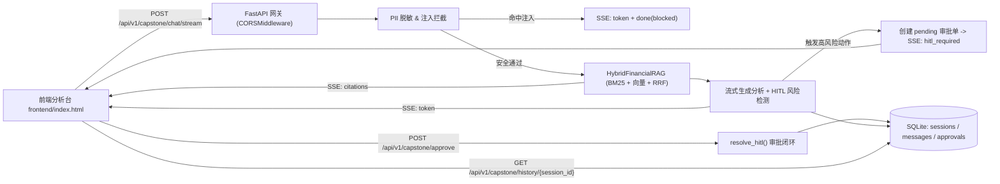

# Day 62 需求文档（PRD）、架构设计与 GitLab 协作记录

## 1. 旁白：Capstone Dev Day 4 —— 全栈前端 UI 与 FastAPI SSE 流式后端集成

> **🎙️ 讲师旁白**：欢迎来到《智枢企业级智能体平台》第六阶段（综合实战与求职冲刺）——**Day 62（Capstone 实战第 4 天）**！在前三天我们完成了毕业项目立项、混合 RAG 引擎与多 Agent 合规审批内核之后，今天我们要把所有后端能力“端到端串起来”，交付一套**真正可交互、可流式观测、可人工审批闭环的企业级全栈 Web 应用**：**《智枢企业财报与合规智能分析台》（`v1.0.0-day62`）**。Tech Lead 张工下发了 **Issue #062**，要求前后端基于 **FastAPI SSE（Server-Sent Events）+ SQLite 持久化 + HITL 挂起恢复** 完成全栈联调上线！

---

## 2. GitLab Issue #062：智枢企业财报与合规智能分析台全栈集成

- **提出人**：产品经理 林晓 / Tech Lead 张工
- **指派给**：全栈 AI 工程师 陈默
- **关联分支**：`feature/day-62-capstone-fullstack`
- **目标版本**：`v1.0.0-day62`

### 2.1 业务与技术需求描述
1. **FastAPI 全栈服务端（`zhishu_agent/capstone_web.py`）**：
   - 启用 `CORSMiddleware` 支持跨域联调；
   - `GET /` 直接托管 `frontend/index.html` 单页分析台；
   - `GET /api/v1/health` 返回服务健康状态与版本号 `v1.0.0-day62`；
   - `POST /api/v1/capstone/chat/stream` 返回 `text/event-stream` SSE 流，依次推送 `status`（合规预检/混合检索/生成阶段）、`citations`（BM25 + 向量 RRF 引用证据）、`token`（逐块流式文本）、`hitl_required`（高风险动作挂起单据）与 `done` 事件；
   - `POST /api/v1/capstone/approve` 处理人工批准（`approved=True`）或拒绝（`approved=False`），更新 SQLite 审批表并追加审计系统消息，防止重复审批（返回 `409 Conflict`）；
   - `GET /api/v1/capstone/history/{session_id}` 返回完整会话消息与审批历史（会话不存在时返回 `404`）。
2. **SQLite 持久化存储（`CapstoneStore`）**：
   - 维护 `sessions`、`messages`、`approvals` 三张核心表；
   - 所有用户输入在入库与检索前强制经过 PII 脱敏（身份证、银行卡、手机号、邮箱）。
3. **企业级前端工作台（`frontend/index.html`）**：
   - 标题为「智枢企业财报与合规智能分析台」；
   - 使用原生 `fetch` + `ReadableStream` 解析 `POST` SSE 帧（突破浏览器原生 `EventSource` 仅支持 `GET` 的限制）；
   - 实时渲染右侧 **Citations 引用证据卡片** 与 **HITL 人工审批面板**（Approve / Reject 按钮）。

---

### 2.2 全栈架构与 SSE + HITL 时序图

> **💡 架构师笔记（为什么用 `fetch` + `ReadableStream` 消费 SSE，而不是 `EventSource`？）**：
> 浏览器原生 `EventSource` API 仅支持 `GET` 请求且无法自定义请求头或携带 JSON Body。而在企业级 AI 对话场景中，用户问题（`query`）、会话上下文（`session_id`）及检索参数（`top_k`）通常通过 `POST` JSON 提交。因此现代全栈 AI 前端普遍采用 `fetch(..., { method: 'POST' })` 读取 `response.body.getReader()`，按 `\n\n` 切分标准 SSE 帧并分发 `event:` 与 `data:`。

---

## 3. GitLab Merge Request !062 评审记录

- **提交说明**：`feat(day-62): 完成 Capstone 全栈前端 UI、FastAPI SSE 流式接口、混合 RAG 与 HITL 审批闭环 (v1.0.0-day62)`
- **Tech Lead 张工 Review 意见**：
  - `[通过]` `create_app(db_path, frontend_dir)` 支持路径注入，测试可完全基于 `tmp_path` 隔离运行，不污染仓库目录。
  - `[通过]` `POST /api/v1/capstone/chat/stream` 正确设置 `Cache-Control: no-cache` 与 `X-Accel-Buffering: no`，避免 Nginx 反向代理缓冲导致前端假死。
  - `[通过]` `resolve_approval` 在事务内校验 `status == 'pending'`，重复审批严格返回 `409 Conflict`，守住资金与披露内控红线。
- **QA 李婷 测试结果**：
  - `pytest project_iterations/day_62/tests -v` 全部 5 组核心测试 100% PASS。
  - `verify_day.py` Notebook 执行与单元测试双校验通过，准予合并至 `main` 并打标 `v1.0.0-day62`。
