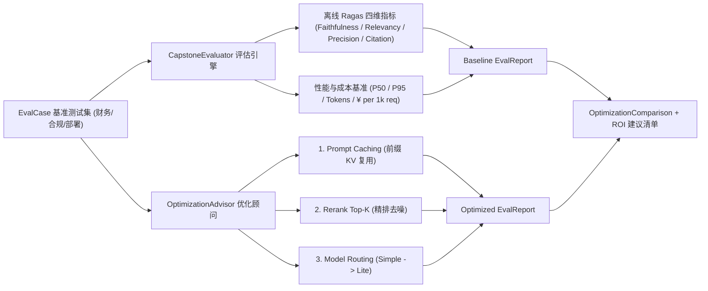

# Day 63 需求文档（PRD）、架构设计与 GitLab 协作记录

## 1. 旁白：Capstone Dev Day 5 —— 毕业设计测试、Ragas 评估报告与性能/成本压测优化

> **🎙️ 讲师旁白**：欢迎来到《智枢企业级智能体平台》第六阶段（综合实战与求职冲刺）——**Day 63（Capstone 实战第 5 天）**！在前四天我们完成了立项、混合 RAG、安全合规与全栈 SSE + HITL 交付后，今天面对企业上线前最关键的一关：**“能跑通”不等于“能上线”**。QA 李婷和 DevOps 赵磊需要一份可量化的**离线 Ragas 质量评估报告**与**性能/Token 成本压测优化方案**。Tech Lead 张工下发了 **Issue #063**，要求陈默交付 `zhishu_agent/capstone_eval.py` 评估与优化引擎，在守住 Ragas 质量门禁的同时，通过 **Prompt Caching + Rerank Top-K 精排裁剪 + 模型分级路由** 把 P95 延迟和千次请求成本打下来！

---

## 2. GitLab Issue #063：智枢平台 Ragas 评估体系与性能/成本压测优化

- **提出人**：QA 李婷 / DevOps 赵磊 / Tech Lead 张工
- **指派给**：全栈 AI 工程师 陈默（PM 林晓 验收 ROI）
- **关联分支**：`feature/day-63-capstone-eval-optimizer`
- **目标版本**：`v1.0.0-day63`

### 2.1 业务与技术需求描述
1. **离线 Ragas 四维质量评估（`CapstoneEvaluator`）**：
   - 基于 Pydantic 定义标准化数据模型 `EvalCase`、`CaseScore`、`PerfBenchmark`、`EvalReport`；
   - 实现无外网依赖的离线 Ragas 风格四维指标：
     - `faithfulness`（忠实度）：生成答案语义单元被检索上下文支撑的比例；
     - `answer_relevancy`（答案相关性）：回答与用户问题及标准答案的语义对齐度；
     - `context_precision`（上下文精确率）：排序靠前检索片段中相关证据的加权占比；
     - `citation_accuracy`（引用准确率）：溯源引用 ID 集合的 F1 准确率；
   - 支持质量门禁判定（`passed_quality_gate`）与结构化 Markdown 报告输出（`EvalReport.to_markdown()`）。
2. **性能与 Token 成本压测基准（`PerfBenchmark` & `PricingConfig`）**：
   - 统计 `p50_ms`、`p95_ms`、`avg_ms`、`tokens_per_req`、`cache_hit_rate` 与 `cost_per_1k_req_cny`；
   - 支持 `flagship` 与 `lite` 双层级模型计费，精确区分未缓存 Input、命中缓存 Input（大幅折价）与 Output Token 成本。
3. **优化顾问与 ROI 量化对比（`OptimizationAdvisor`）**：
   - 模拟并对比 Baseline 与三重优化组合策略：
     1. **Prompt Caching**：复用固定 System Prompt 与合规红线前缀（约 55% Prompt Token 命中缓存）；
     2. **Rerank Top-K 调优**：精排后仅保留 Top-K 高相关片段，剔除尾部噪声并提升 `context_precision`；
     3. **Model Routing**：将简单制度查询路由至 `lite` 模型，复杂多跳财报分析保留 `flagship` 模型；
   - 输出 `OptimizationComparison` 对比报告与月均 10 万次调用的 ROI 节省金额（CNY）。

---

### 2.2 Ragas 评估与性能/成本优化闭环架构图

> **💡 架构师笔记（为什么必须将 Ragas 质量评估与 FinOps 成本压测绑定？）**：
> 在企业级 AI 落地中，单纯压缩上下文或无脑切换小模型确实能降本，但往往会导致“幻觉率飙升”或“引用丢失”。只有把 **Ragas 质量门禁** 与 **P95 延迟 / 千次成本** 放在同一张对比看板上，才能向 PM 与业务方证明：**优化方案是在质量持平甚至提升（`ragas_delta >= 0`）的前提下实现的真降本增效**。

---

## 3. GitLab Merge Request !063 评审记录

- **提交说明**：`feat(day-63): 完成 Capstone Ragas 离线评估引擎、P50/P95 性能压测与成本优化顾问 (v1.0.0-day63)`
- **Tech Lead 张工 Review 意见**：
  - `[通过]` `tokenize_mixed` 同时支持英文数字词与中文单字/双字词组，离线评估无需下载任何第三方模型即可稳定运行，CI 环境零抖动。
  - `[通过]` `PricingConfig.calculate_cost_cny` 对 `cached_tokens > prompt_tokens` 做了边界钳位，防止异常输入导致负成本。
- **QA 李婷 测试结果**：
  - `pytest project_iterations/day_63/tests -v` 全部 5 组核心测试 100% PASS。
  - `verify_day.py` Notebook 执行与单元测试双校验通过。
- **DevOps 赵磊 & PM 林晓 验收结论**：
  - 优化后 P95 延迟降低 **27.76%**，千次请求成本降低 **60.02%**（月均 10 万次调用预计节省 **¥3,209.86**），且综合 Ragas 评分不降反升（`+0.0057`），准予合并并打标 `v1.0.0-day63`。
