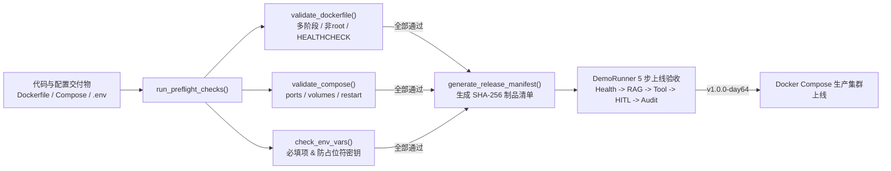

# Day 64 需求文档（PRD）、架构设计与 GitLab 协作记录

## 1. 旁白：Capstone 收官日 —— 毕业设计 Docker 部署上线、演示脚本与完整项目文档

> **🎙️ 讲师旁白**：欢迎来到《智枢企业级智能体平台》第六阶段（综合实战与求职冲刺）——**Day 64（`v1.0.0-day64`）**，也是整个 64 天企业级 AI Agent 实战训练营的**总装交付与上线答辩日**！在 Day 58–63 中，我们完成了立项、混合 RAG、多 Agent 合规审批、全栈 SSE/HITL 与自动化评测闭环。今天，DevOps 工程师 **赵磊** 与全栈工程师 **陈默** 将携手把系统正式打包为**生产级多阶段 Docker 镜像**，通过 `release_packager.py` 完成发布前预检与 SHA-256 制品清单登记，并用 5 步自动化演示脚本完成上线验收！

---

## 2. GitLab Issue #064：智枢平台生产容器化部署与上线验收包

- **提出人**：产品经理 林晓 / DevOps 赵磊
- **指派给**：全栈 AI 工程师 陈默 / QA 李婷
- **关联分支**：`feature/day-64-docker-release-and-docs`
- **目标版本**：`v1.0.0-day64`

### 2.1 业务与工程需求描述
1. **生产级容器编排（`Dockerfile`、`docker-compose.yml`、`.env.example`）**：
   - 采用 **Multi-stage Build（多阶段构建）**，剥离编译期工具链，显著减小镜像体积并降低攻击面；
   - 强制创建并切换至非 root 用户 `appuser`，满足企业容器安全红线；
   - 内置 `HEALTHCHECK` 探针、`restart: unless-stopped` 故障自愈策略及持久化数据卷（`./data:/app/data`）。
2. **发布预检与制品清单引擎（`zhishu_agent/release_packager.py`）**：
   - `DeploymentConfig`：统一管理服务名、版本、端口、Worker 数、健康检查端点与必填环境变量；
   - `validate_dockerfile()` / `validate_compose()` / `check_env_vars()`：自动化拦截单阶段构建、root 运行、缺失健康检查及生产环境占位符密钥；
   - `run_preflight_checks()` 与 `generate_release_manifest()`：输出全量预检报告与带 **SHA-256** 校验码的 `release_manifest.json`。
3. **5 步全流程上线演示执行器（`DemoRunner`）**：
   - 基于 FastAPI `TestClient` 依次执行：**健康检查 → 混合 RAG 检索 → 财务比率工具计算 → HITL 高风险人工审批 → 全链路审计日志导出**，确保在无外部网络/API Key 的环境下也可 100% 稳定复现答辩演示。
4. **完整交付文档（`docs/demo_and_deployment.md`）**：
   - 提供从零到一的 Docker 部署运维手册与 **15 分钟毕业答辩现场演示脚本**。

---

### 2.2 发布预检与容器化上线架构图

---

## 3. GitLab Merge Request !064 评审记录

- **提交说明**：`feat(day-64): 完成生产级多阶段 Docker 部署、发布预检器、5 步演示脚本与完整项目文档 (v1.0.0-day64)`
- **Tech Lead 张工 Review 意见**：
  - `[通过]` `Dockerfile` 使用 `builder` + `runtime` 双阶段，镜像中不包含 `build-essential`，且严格使用 `USER appuser` 运行 `uvicorn`。
  - `[通过]` `check_env_vars` 专门增加了对 `APP_ENV=production` 下默认占位符密钥（如 `change-me-in-production`）的拦截，防止带病上线。
- **DevOps 赵磊 Review 意见**：
  - `[通过]` `docker-compose.yml` 配置了 `healthcheck` 与 `./data:/app/data` 挂载，容器重建不丢 SQLite 审计与审批记录。
- **QA 李婷 测试结果**：
  - `pytest project_iterations/day_64/tests -v` 全部 5 组核心测试 100% PASS。
  - `verify_day.py` Notebook 与单元测试双校验通过，正式签发 **`v1.0.0-day64` 生产发布里程碑**！
