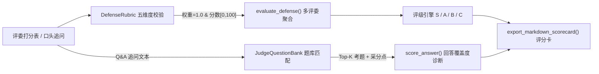

# Day 65 需求文档（PRD）、架构设计与 GitLab 协作记录

## 1. 旁白：毕业答辩冲刺 —— 15 分钟全栈演示 + 10 分钟企业评委硬核问答与评分引擎

> **🎙️ 讲师旁白**：欢迎来到《星辰数科 · 智枢企业级智能体平台（ZhiShu-Agent）》第六阶段最后一课——**Day 65（`v1.0.0-day65`）毕业答辩日**！经过 64 天的体系化工程实战，我们已经交付了从混合 RAG、多 Agent 编排、HITL 人工审批、安全脱敏到 FastAPI SSE 全栈应用与生产可观测性的完整平台。今天，产品经理林晓与 Tech Lead 张工下发 **Issue #065**，要求构建一套**「企业级毕业答辩评分引擎与评委问答模拟器」**，并配套 15 分钟演示脚本与 10 分钟企业评委硬核问答手册，帮助全队以 S 级水准完成最终交付验收！

---

## 2. GitLab Issue #065：企业级毕业答辩评分引擎与答辩演练手册

- **提出人**：产品经理 林晓 / Tech Lead 张工
- **指派给**：全栈 AI 工程师 陈默 / QA 李婷 / DevOps 赵磊
- **关联分支**：`feature/day-65-capstone-defense`
- **目标版本**：`v1.0.0-day65`

### 2.1 业务与技术需求描述
1. **五维度加权答辩评分标准（`DefenseRubric`）**：
   - `business_value`（业务价值）：**20%**
   - `architecture_depth`（技术架构与 RAG/Agent 深度）：**30%**
   - `engineering_quality`（工程质量与可观测性）：**20%**
   - `demo_fluency`（演示流畅度）：**15%**
   - `qa_performance`（评委问答表现）：**15%**
   - 必须严格校验权重之和等于 `1.0` 且单项分数位于 `[0, 100]`。
2. **企业评委硬核题库与应答诊断（`JudgeQuestionBank`）**：
   - 覆盖 5 大高频企业级追问：`幻觉治理`、`高并发成本`、`权限隔离`、`HITL超时`、`微调vs RAG选型`；
   - 支持按评委口头提问关键词实时匹配最相关考题（`match_question`），并基于采分点评估候选人回答覆盖率（`score_answer`）。
3. **多评委聚合与评分卡导出（`evaluate_defense` & `export_markdown_scorecard`）**：
   - 聚合多位评委打分，计算加权总分与等级划分（`S` ≥ 90 / `A` ≥ 80 / `B` ≥ 70 / `C` < 70）；
   - 自动提炼核心优势亮点与针对性改进计划（Action Items），并导出结构化 Markdown 评分卡。

---

### 2.2 答辩评分引擎与 Q&A 模拟架构图

> **💡 架构师笔记（为什么把「答辩评分」也做成工程化引擎？）**：
> 在真实企业的技术立项评审（Architecture Review Board, ARB）与晋升答辩中，主观拍脑袋打分极易导致“只看 Demo 不看工程底座”的偏差。通过 `DefenseRubric` 将技术深度（30%）与工程可观测性（20%）固化为 50% 的硬性权重，并用 `JudgeQuestionBank` 对高并发成本、权限隔离与 HITL 超时等生产边界问题进行采分点量化，能够确保团队在交付前完成全方位的压力自检。

---

## 3. GitLab Merge Request !065 评审记录

- **提交说明**：`feat(day-65): 完成毕业答辩五维度评分引擎、企业评委Q&A模拟器与15+10分钟答辩剧本 (v1.0.0-day65)`
- **Tech Lead 张工 Review 意见**：
  - `[通过]` `evaluate_defense` 直接基于未四舍五入的维度均分加权求和，避免了逐项舍入导致的边界漂移（如 `69.5` 边界精确保持 `69.50`）。
  - `[通过]` `DefenseRubric` 支持维度 `key` 与中文名称双索引，且对缺失维度、越界分数与非法权重均抛出明确 `ValueError`。
- **QA 李婷 测试结果**：
  - `pytest project_iterations/day_65/tests -v` 5 组核心单元测试 100% PASS。
  - `verify_day.py` Notebook 端到端执行与单元测试双校验通过，正式打标 `v1.0.0-day65`，准予毕业结项！
