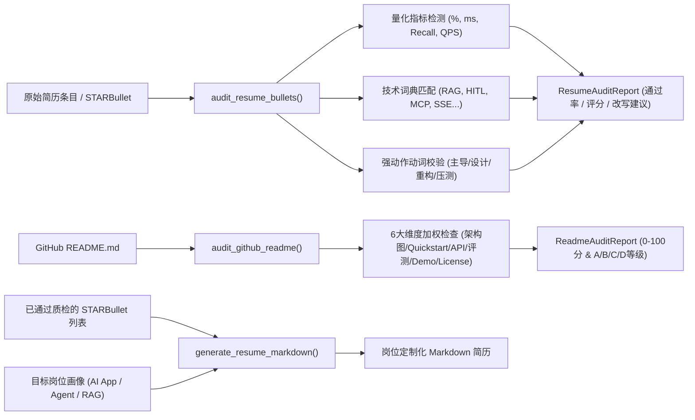

# Day 66 需求文档（PRD）、架构设计与 GitLab 协作记录

## 1. 旁白：简历与作品集打磨 —— 把工程实力翻译成面试官看得懂的“高价值信号”

> **🎙️ 讲师旁白**：欢迎来到《智枢企业级智能体平台》第六阶段（综合实战与求职冲刺）——**Day 66（`v1.0.0-day66`）**！很多同学明明做了 60 多天的企业级 RAG、Multi-Agent、HITL 审批与 FastAPI SSE 全栈开发，但简历上却只写了一句“*负责公司智能体开发，效果不错*”，GitHub 仓库也只有裸代码和一行 `# AI-Agent`，导致简历初筛直接被刷。今天，Tech Lead 张工和 PM 林晓下发了 **Issue #066**：用工程化思维打造 **STAR 法则简历生成器** 与 **GitHub README 质量检查器**，用自动化规则把你的项目经历与开源作品集打磨到一线大厂投递水准！

---

## 2. GitLab Issue #066：STAR 简历生成器与 GitHub README 质量检查器

- **提出人**：产品经理 林晓 / Tech Lead 张工
- **指派给**：全栈 AI 工程师 陈默
- **协同评审**：QA 李婷 / DevOps 赵磊
- **关联分支**：`feature/day-66-portfolio-builder`
- **目标版本**：`v1.0.0-day66`

### 2.1 业务与技术需求描述
1. **STAR 结构化条目建模与格式化（`STARBullet` / `format_star_bullet`）**：
   - 强制约束 `Situation`（业务痛点）、`Task`（承担职责）、`Action`（技术选型与工程动作）、`Result`（可验证量化结果）四要素非空；
   - 自动提取并校验量化指标（百分比 `%`、延迟 `ms/s`、倍率 `倍/x`、召回率 `Recall@K`、吞吐 `QPS` 等）。
2. **简历空洞表述质检器（`audit_resume_bullets`）**：
   - 支持同时接收原始字符串或 `STARBullet` 对象；
   - 自动拦截三类高频“简历毒药”：无量化指标、无 AI/工程核心技术词、使用“参与/了解”等弱动作词，并输出具体改写建议与 0–100 评分。
3. **GitHub README 作品集质量检查器（`audit_github_readme`）**：
   - 围绕招聘方/技术面试官关注的 6 大维度进行加权评分（满分 100）：
     - 系统架构图（20 分，Mermaid/Architecture）
     - 快速开始与可复现命令（20 分，Quickstart + CLI/pytest）
     - API 接口文档（20 分，Endpoint + 示例）
     - 量化评测基线（20 分，Benchmarks / Recall / Latency）
     - 演示动图或截图（10 分，GIF / Screenshot）
     - 开源协议（10 分，MIT / Apache-2.0 License）
   - 输出等级（`A/B/C/D`）、缺失清单与补全建议。
4. **多岗位定制简历生成（`generate_resume_markdown`）**：
   - 面向 **AI Application Engineer**、**Agent Engineer**、**RAG Engineer** 三类核心岗位，自动匹配岗位画像、核心技能矩阵，并根据 `role_tags` 与技术关键词相关性动态重排项目经历顺序。

---

### 2.2 模块架构与质检流水线

---

## 3. GitLab Merge Request !066 评审记录

- **提交说明**：`feat(day-66): 实现 STAR 简历生成器、简历条目质检器与 GitHub README 质量评分器 (v1.0.0-day66)`
- **Tech Lead 张工 Review 意见**：
  - `[通过]` `audit_resume_bullets()` 同时兼容纯文本草稿和 `STARBullet` 对象，方便学员先用旧简历跑一次“体检”，再逐条重构成 STAR 格式。
  - `[通过]` `generate_resume_markdown()` 支持中英文岗位名称别名映射，并按岗位关键词权重对项目经历重新排序，避免“千人一面”的通用简历。
- **QA 李婷 测试结果**：
  - `pytest project_iterations/day_66/tests -v` 全部 5 组核心测试 100% PASS。
  - `verify_day.py` Notebook 执行与单元测试双校验通过，准予合并至 `main` 并打标 `v1.0.0-day66`。
