# Day 67 需求文档（PRD）、架构设计与 GitLab 协作记录

## 1. 旁白：面试专题（一）—— 技术八股与模拟笔试

> **🎙️ 讲师旁白**：欢迎来到《智枢企业级智能体平台》第六阶段（综合实战与求职冲刺）——**Day 67（`v1.0.0-day67`）**！简历通过初筛只是第一步，接下来等待你的是大厂笔试与一面/二面的“高频技术八股连环炮”：*为什么 Self-Attention 要除以 $\sqrt{d_k}$？KV Cache 为什么会变成 Memory-Bound？BM25+Vector 为什么用 RRF 融合？FastAPI 里调同步阻塞库会怎样？* 很多同学项目写得出来，一到面试口述就丢三落四、抓不住得分点。今天，PM 林晓和 Tech Lead 张工下发了 **Issue #067**：打造**高频技术八股题库与模拟笔试自动评分系统（`interview_bank.py`）**，用“要点覆盖率评分 + 薄弱维度诊断 + 靶向复习计划”帮你把技术理解打磨成精准的高分答案！

---

## 2. GitLab Issue #067：技术八股题库与模拟笔试自动评分引擎

- **提出人**：产品经理 林晓 / Tech Lead 张工
- **指派给**：全栈 AI 工程师 陈默
- **协同评审**：QA 李婷 / DevOps 赵磊
- **关联分支**：`feature/day-67-interview-bank`
- **目标版本**：`v1.0.0-day67`

### 2.1 业务与技术需求描述
1. **结构化面试题库建模（`InterviewQuestion` / `KeyPoint`）**：
   - 覆盖五大核心技术维度：`Transformer`（原理与推理优化）、`RAG`（检索与评估）、`Agent`（架构与 Tool Use）、`Python`（异步与 FastAPI）、`Engineering`（大模型工程与安全）；
   - 每道题包含 `id`、`category`、`difficulty`（`Easy`/`Medium`/`Hard`）、`question`、带权重与同义关键词列表的 `key_points`，以及标准参考答案 `model_answer`；
   - 内置至少 15 道（实际交付 20 道，每维度 4 题）大厂高频真题，并支持按维度与难度动态筛选。
2. **要点覆盖率自动评分引擎（`grade_answer()`）**：
   - 对空字符串或纯空白作答做显式边界处理（`score=0.0`，`is_empty=True`，返回引导性评语与全部缺失要点）；
   - 对有效作答进行大小写与空白规范化后匹配每个 `KeyPoint` 的同义关键词簇，按权重计算 0–100 分、要点覆盖率 `coverage_ratio`，并清晰列出 `matched_points` 与 `missing_points`。
3. **模拟笔试会话与薄弱维度诊断（`ExamSession` / `ExamReport`）**：
   - `ExamSession.select_questions()` 支持均衡跨维度抽题（可指定随机种子以保证教学演示与单测可复现）；
   - `finish_exam(weak_threshold=70.0)` 自动聚合各维度均分，按得分从低到高识别薄弱维度 `weak_categories`，并生成带优先级（`High`/`Medium`）与行动建议的 `study_plan`；
   - 支持导出结构化字典、JSON（`to_json()`）与 Markdown 诊断报告（`to_markdown()`）。

---

### 2.2 模块架构与评分流水线

```mermaid
flowchart LR
    BANK["内置 20 题高频八股题库<br/>(Transformer / RAG / Agent / Python / Engineering)"] --> SELECT["ExamSession.select_questions()<br/>均衡跨维度组卷"]
    SELECT --> SUBMIT["submit_answer(qid, answer)<br/>逐题提交作答"]
    SUBMIT --> GRADE["grade_answer()<br/>空答拦截 + 加权要点关键词匹配"]
    GRADE --> RES["AnswerGradeResult<br/>(得分 / 覆盖率 / 命中&缺失要点 / 评语)"]
    RES --> FINISH["finish_exam(weak_threshold=70.0)"]
    FINISH --> DIAG["各维度均值聚合 & 薄弱项排序"]
    DIAG --> PLAN["StudyPlanItem<br/>(High/Medium 优先级 + 靶向复习计划)"]
    PLAN --> EXPORT["ExamReport<br/>(to_markdown / to_json)"]
```

---

## 3. GitLab Merge Request !067 评审记录

- **提交说明**：`feat(day-67): 实现 20 题五大维度技术八股题库、要点覆盖评分引擎与模拟笔试诊断报告 (v1.0.0-day67)`
- **Tech Lead 张工 Review 意见**：
  - `[通过]` `KeyPoint` 采用“主描述 + 多同义关键词 + 权重”设计，既能容忍口语化/中英文混排表达，又能精准区分核心原理与次要细节。
  - `[通过]` `ExamSession.select_questions()` 优先保证每个目标维度至少抽中 1 题，避免随机抽题出现“偏科试卷”。
- **QA 李婷 测试结果**：
  - `pytest project_iterations/day_67/tests -v` 全部 5 组核心测试（题库完整性与筛选、要点覆盖评分、空答边界、薄弱维度诊断、报告导出）100% PASS。
  - `verify_day.py` Notebook 执行与单元测试双校验通过，准予合并至 `main` 并打标 `v1.0.0-day67`。
