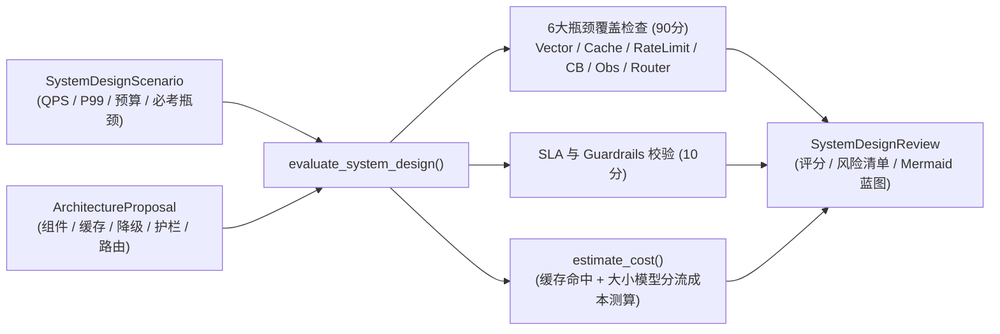

# Day 68 需求文档（PRD）、架构设计与 GitLab 协作记录

## 1. 旁白：面试专题（二）—— 从“写过代码”到“扛得住项目深挖与系统设计”

> **🎙️ 讲师旁白**：欢迎来到《智枢企业级智能体平台》第六阶段（综合实战与求职冲刺）——**Day 68（`v1.0.0-day68`）**！在简历过关之后，真正决定你能否拿到大厂高级 AI 工程师 Offer 的，是二面与三面的**项目深挖（Deep-Dive）**与 **AI 系统设计（System Design）**。面试官不会满足于“我用了 LangGraph + Milvus 做了一个 RAG”，他会连续追问：“*100万文档下 HNSW 带权限过滤召回暴跌怎么办？大促 QPS 翻 3 倍怎么限流降级？大模型月账单翻倍怎么通过缓存与大小模型路由压下来？*”今天，Tech Lead 张工和 PM 林晓下发了 **Issue #068**：在智枢平台中构建 **AI 系统设计与项目深挖评估器（`system_design_sim`）**，用量化评分、成本估算与 Mermaid 架构蓝图自动诊断你的系统设计盲区！

---

## 2. GitLab Issue #068：AI 系统设计与项目深挖评估器

- **提出人**：产品经理 林晓 / Tech Lead 张工
- **指派给**：全栈 AI 工程师 陈默
- **协同评审**：QA 李婷 / DevOps 赵磊
- **关联分支**：`feature/day-68-system-design-sim`
- **目标版本**：`v1.0.0-day68`

### 2.1 业务与技术需求描述
1. **高频面试场景建模（`SystemDesignScenario`）**：
   - 内置三大高频 AI 系统设计考题：
     - `enterprise_kb_1m`：100万文档企业知识库 RAG 平台（200 QPS，P99 ≤ 1200ms，月预算 ¥35,000）
     - `high_concurrency_cs`：高并发电商/金融智能客服系统（1000 QPS，P99 ≤ 800ms，月预算 ¥85,000）
     - `multi_agent_fin_research`：多 Agent 金融研报分析助手（50 QPS，P99 ≤ 8000ms，月预算 ¥45,000）
   - 每个场景附带标准 SLA、数据规模、日请求量及“项目深挖必问追问清单”。
2. **候选人架构方案建模（`ArchitectureProposal`）**：
   - 涵盖核心组件列表（`components`）、吞吐与延迟指标（`target_qps` / `expected_p99_ms`）、缓存策略（`caching`）、熔断降级（`fallback`）、安全护栏（`guardrails`）与成本控制（`cost_control`）。
3. **六大架构瓶颈覆盖度与 SLA 评估（`evaluate_system_design`）**：
   - 对 6 大关键生产瓶颈进行加权核查（各 15 分，共 90 分）：
     - `vector_index`（向量索引分片与混合检索/重排）
     - `semantic_cache`（Redis 语义缓存）
     - `rate_limiting`（网关令牌桶限流与背压）
     - `circuit_breaker`（供应商熔断与轻量模型降级）
     - `observability`（OTel / Langfuse / Prometheus 全链路 Trace）
     - `cost_routing`（大小模型路由与租户配额）
   - 叠加 SLA 达标与安全护栏校验（10 分），输出 0–100 综合评分、`S/A/B/C/D` 等级、缺失瓶颈清单及可落地的改进建议。
4. **成本估算与 Mermaid 架构蓝图生成（`estimate_cost` / `generate_mermaid_blueprint`）**：
   - 根据语义缓存命中率与大小模型分流比例计算日均/月度推理账单，判断是否超出场景预算；
   - 自动生成带状态标注（正常 / ⚠️缺失预警）的 `flowchart LR` Mermaid 架构蓝图。

---

### 2.2 评估流水线架构图

---

## 3. GitLab Merge Request !068 评审记录

- **提交说明**：`feat(day-68): 实现 AI 系统设计与项目深挖评估器及面试场景库 (v1.0.0-day68)`
- **Tech Lead 张工 Review 意见**：
  - `[通过]` `_collect_proposal_corpus()` 严格只扫描技术描述字段（排除 `proposal_name`），避免方案标题中的修饰语干扰瓶颈关键词检测，设计严谨。
  - `[通过]` `estimate_cost()` 对多 Agent 场景引入 3.5x 调用放大系数，贴合真实生产中 Planner + Tool Call 多轮推理的 Token 消耗特征。
- **DevOps 赵磊 意见**：
  - `[通过]` Mermaid 蓝图直接暴露缺失的限流、熔断与 OTel 可观测节点，非常适合在架构评审会与面试白板阶段快速对齐风险。
- **QA 李婷 测试结果**：
  - `pytest project_iterations/day_68/tests -v` 全部 5 组核心测试 100% PASS。
  - `verify_day.py` Notebook 执行与单元测试双校验通过，准予合并至 `main` 并打标 `v1.0.0-day68`。
