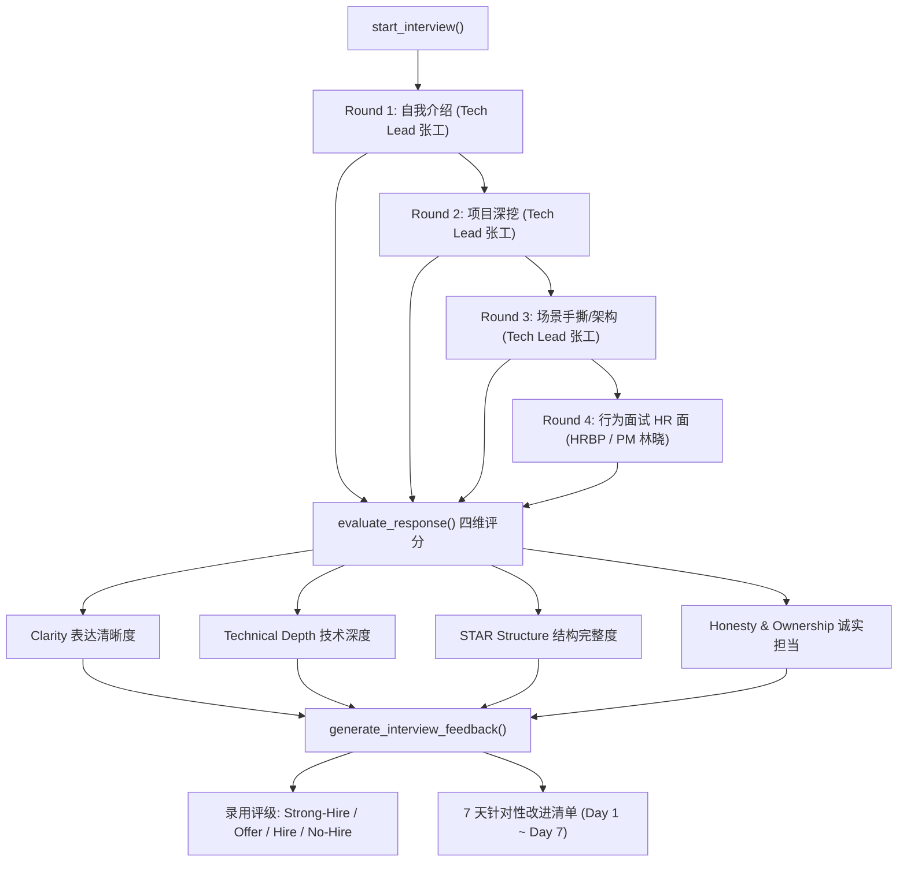

# Day 69 需求文档（PRD）、架构设计与 GitLab 协作记录

## 1. 旁白：一对一全真模拟面试日 —— 在上场前完成“高压脱敏”

> **🎙️ 讲师旁白**：欢迎来到《智枢企业级智能体平台》第六阶段（综合实战与求职冲刺）——**Day 69（`v1.0.0-day69`）**！简历通过初筛、GitHub 作品集拿到关注之后，真正决定 Offer 归属的是 **一对一全真模拟面试**。很多同学技术栈不差，却在真实面试中栽在三个地方：自我介绍没有记忆点、项目深挖被追问到边界就慌神、HR 行为面只会甩锅或空谈“性格好”。今天，Tech Lead 张工和 PM 林晓联合下发 **Issue #069**：构建全闭环 **MockInterviewEngine（技术面 + HR 面全真模拟面试引擎）**，用自动化四维评分与 7 天针对性改进清单，帮你在正式面试前完成一轮高保真压力演练！

---

## 2. GitLab Issue #069：全闭环模拟面试引擎（技术面 + HR 面）

- **提出人**：产品经理 林晓 / Tech Lead 张工
- **指派给**：全栈 AI 工程师 陈默
- **协同评审**：QA 李婷 / DevOps 赵磊
- **关联分支**：`feature/day-69-mock-interview`
- **目标版本**：`v1.0.0-day69`

### 2.1 业务与技术需求描述
1. **四轮结构化面试状态机（`MockInterviewEngine`）**：
   - 严格按 `自我介绍 -> 项目深挖 -> 场景手撕/架构 -> 行为面试 HR 面` 四轮流转；
   - 前三轮归属 **技术面（Technical Round，权重 70%）**，由 `Tech Lead 张工` 主导；第四轮归属 **HR 行为面（HR Round，权重 30%）**，由 `HRBP / PM 林晓` 主导。
   - 支持 `start_interview()`、`current_round()`、`submit_response()`、`is_finished` 与 `progress` 状态追踪，已结束会话再次提交需抛出 `RuntimeError` 防越界。
2. **四维量化评估模型（`evaluate_response` / `DimensionScores`）**：
   - **Clarity（表达清晰度）**：检测结构化连接词（首先/其次/最后/因此）、句数与篇幅合理性；
   - **Technical Depth（技术深度）**：匹配 AI/Agent/工程核心关键词（`RAG`、`BM25`、`RRF`、`HITL`、`SSE`、`幂等`、`熔断`、`P95` 等）与可验证量化指标；
   - **STAR Structure（STAR 完整度）**：校验 `Situation`、`Task`、`Action`、`Result` 四要素闭环；
   - **Honesty & Ownership（诚实度与主人翁意识）**：识别“我主导/我负责/复盘/边界/承认”等正向信号，惩罚“都是别人/完美无缺”等推诿或虚浮表述。
   - **空回答安全兜底**：空字符串或纯空白作答全维度计 `0.0` 分，`is_empty=True`，不触发异常。
3. **录用决策与 7 天改进清单（`generate_interview_feedback`）**：
   - 综合技术面与 HR 面得分，输出四档录用建议：`Strong-Hire`、`Offer`、`Hire`、`No-Hire`；
   - 自动识别候选人最弱与次弱维度，动态生成可执行、带交付物的 **7 天冲刺改进清单（`ChecklistItem`）** 及 Markdown 复盘报告。

---

### 2.2 模块架构与评估流水线

---

## 3. GitLab Merge Request !069 评审记录

- **提交说明**：`feat(day-69): 实现技术面+HR面全闭环模拟面试引擎与7天改进清单生成器 (v1.0.0-day69)`
- **Tech Lead 张工 Review 意见**：
  - `[通过]` 技术面与 HR 面采用差异化维度权重（技术面 `technical_depth` 占 45%，HR 面 `honesty_ownership` 与 `star_structure` 各占 35%），符合大厂真实打分卡逻辑。
  - `[通过]` 7 天改进清单的 Day 1 与 Day 5 会动态绑定本场最低与次低能力维度，避免泛泛而谈的模板化建议。
- **QA 李婷 测试结果**：
  - `pytest project_iterations/day_69/tests -v` 全部 5 组核心测试（轮次流转、技术与 HR 权重差异、录用阈值、空回答处理、7 天清单生成）100% PASS。
  - `verify_day.py` Notebook 执行与单元测试双校验通过，准予合并至 `main` 并打标 `v1.0.0-day69`。
