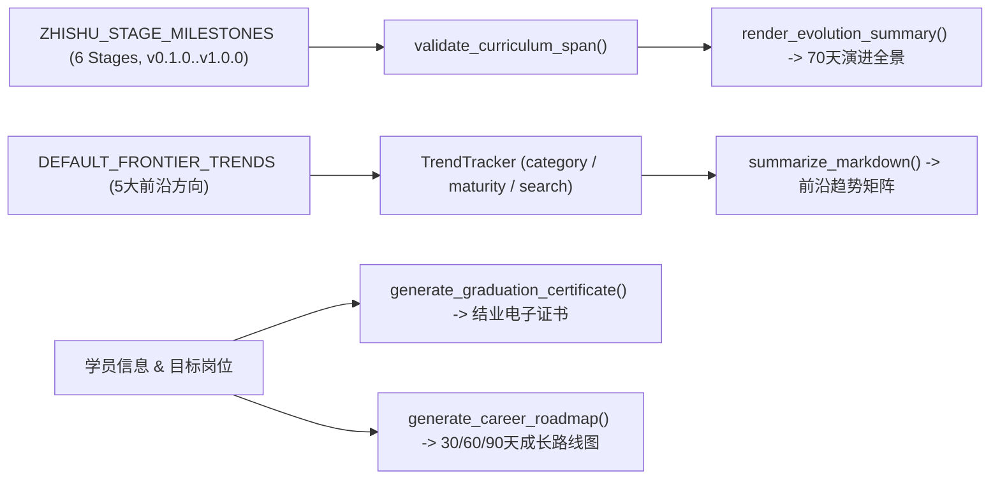

# Day 70 需求文档（PRD）、架构设计与 GitLab 协作记录

## 1. 旁白：结业日 —— 从 70 天工程实战走向下一代 AI Agent 架构师

> **🎙️ 讲师旁白**：欢迎来到《星辰数科 · 智枢企业级智能体平台》70 天实战营的收官之战——**Day 70（`v1.0.0-day70` 结业日）**！从 Day 01 写下第一行带类型注解的 Python 函数，到今天交付集 **Hybrid RAG、Multi-Agent、MCP 协议、HITL 安全审批、vLLM 云原生部署与全栈 SSE 交互**于一体的 `ZhiShu-Agent v1.0.0`，我们用 70 个真实企业级迭代完成了一次完整的工程蜕变。今天，PM 林晓与 Tech Lead 张工签发了 **Issue #070**：打造智枢平台结业全景总结、2025–2026 前沿技术趋势追踪器与 30/60/90 天职业发展路线图生成器，为每一位毕业学员颁发结业数字凭证并点亮未来 90 天的进阶航标！

---

## 2. GitLab Issue #070：70天全景回顾、前沿趋势追踪与结业路线图生成

- **提出人**：产品经理 林晓 / Tech Lead 张工
- **指派给**：全栈 AI 工程师 陈默
- **协同评审**：QA 李婷 / DevOps 赵磊
- **关联分支**：`release/day-70-graduation`
- **目标版本**：`v1.0.0-day70`

### 2.1 业务与技术需求描述
1. **六阶段演进里程碑与 70 天跨度校验（`StageMilestone` / `validate_curriculum_span`）**：
   - 结构化沉淀 Day 01–14 (`v0.1.0`)、Day 15–24 (`v0.2.0`)、Day 25–38 (`v0.3.0`)、Day 39–50 (`v0.4.0`)、Day 51–57 (`v0.5.0`)、Day 58–70 (`v1.0.0`) 共 6 大阶段；
   - 自动校验阶段编号连续、天数跨度严格覆盖 Day 01 到 Day 70（零断档、零重叠），并输出 Markdown 演进全景表。
2. **2025–2026 前沿 AI Agent 趋势追踪器（`TrendTracker`）**：
   - 覆盖五大核心演进方向：**推理增强模型（o1 / DeepSeek-R1）**、**MCP 与智能体互操作协议**、**多模态与 GUI 操纵智能体**、**实时语音全双工智能体**、**端侧与边缘智能体**；
   - 支持按技术类别（`category`）、成熟度（`maturity`）与关键词（`search`）多维过滤，并关联对智枢平台的架构演进建议。
3. **结业电子证书生成器（`generate_graduation_certificate`）**：
   - 校验学员姓名与完成天数（1–70 天），生成包含版本主线（`v0.1.0 -> v1.0.0`）、认证岗位方向与星辰数科教研委员会签章的 Markdown 结业证书。
4. **结业后 30 / 60 / 90 天职业发展路线图（`generate_career_roadmap`）**：
   - 面向 **Agent Engineer**、**RAG Engineer**、**AI Application Engineer** 三大方向，输出可勾选的 30 天（求职突破）、60 天（前沿攻坚）、90 天（生产跃迁）Markdown 行动清单。

---

### 2.2 模块架构与结业交付流水线

---

## 3. GitLab Merge Request !070 评审记录

- **提交说明**：`feat(day-70): 完成 70 天演进里程碑校验、前沿趋势追踪器、结业证书与 30/60/90 天职业路线图 (v1.0.0-day70)`
- **Tech Lead 张工 Review 意见**：
  - `[通过]` `validate_curriculum_span()` 对 6 个阶段的起止天数和版本主线做了强契约校验，确保课程体系与平台迭代历史 100% 对齐。
  - `[通过]` `TrendTracker` 将行业前沿趋势与智枢平台具体模块改造动作绑定，避免了空泛的概念罗列。
- **DevOps 赵磊 交付确认**：
  - 全仓 70 个日迭代版本（`day_01` ~ `day_70`）均可独立运行且零外部 API 依赖。
- **QA 李婷 测试结果**：
  - `pytest project_iterations/day_70/tests -v` 全部 5 组核心测试 100% PASS。
  - `verify_day.py` Notebook 执行与单元测试双校验通过，正式发布 **`v1.0.0-day70` 结业里程碑**！
