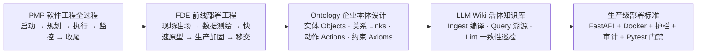

# 智枢平台工程升级白皮书：PMP 全生命周期 × Ontology 本体设计 × LLM Wiki × FDE 前线部署工程

> 基于「70 天零基础大模型应用开发实战体系」沉淀，面向生产级交付的 **7 大行业高频企业级 AI 项目** 总控方法论。

---

## 1. 四维融合工程方法论

### 1.1 LLM Wiki（活体编译型知识库）
区别于传统无状态 RAG（每次检索临时拼装碎片），本项目群全面采用 **LLM Wiki** 范式：
- **Ingest（增量编译）**：新文档进入后，自动抽取实体、更新 `wiki/entities/*.md` 百科词条、维护双向链接 `[[Entity]]`，并追加 `wiki/log.md` 变更日志与 `wiki/index.md` 全局目录。
- **Query（图谱+语义联合问答）**：优先沿本体关系与 Wiki 词条图谱检索，结合 BM25/向量混合召回，输出带 `[[词条]]` 与文档切片双重溯源的结论。
- **Lint（知识库巡检）**：定期扫描孤立节点、冲突数值、过期条目与未闭合引用，确保企业知识库持续自洽。

### 1.2 Ontology（企业领域本体设计）
借鉴 Palantir Foundry Ontology 理念，每个行业项目均以强类型 Pydantic 本体模型为核心契约：
- **Object Types（实体类型）**：如金融的 `Company / FinancialReport / RiskEvent`，医疗的 `Patient / Symptom / ClinicalGuideline`。
- **Link Types（语义关系）**：如 `HAS_RISK`、`CONTRAINDICATES`、`GOVERNS`，支持多跳图谱推理。
- **Action Types（受控业务动作）**：所有 Agent 工具调用均绑定本体动作，受前置条件、RBAC 权限与 HITL 审批门禁约束。

### 1.3 FDE（Forward Deployed Engineer 前线部署工程）
模拟一线 AI 交付工程师从业务现场到生产上线的 5 步闭环：
1. **Shadowing & Discovery**：对齐业务痛点与 KPI，输出项目章程（Charter）。
2. **Ontology & Data Mapping**：将企业异构数据（CSV/JSON/Markdown/日志）映射为标准本体。
3. **Rapid Vertical Slice**：构建端到端可运行原型（API + Wiki + Agent）。
4. **Production Hardening**：接入 PII 脱敏、Prompt 注入防御、限流、健康检查、多阶段 Docker。
5. **Handover & Runbook**：交付可观测指标、应急预案与运维移交清单。

### 1.4 PMP 软件工程 0 到 1 全过程
每个行业项目均在 `docs/pmp/` 目录下完整落盘 PMP 五大过程组文档：
1. `01_initiating_charter.md`（启动：项目章程、商业论证、干系人登记册）
2. `02_planning_wbs_and_ontology.md`（规划：WBS、里程碑、风险登记册、领域本体与 Wiki 架构）
3. `03_executing_fde_delivery.md`（执行：FDE 交付实施、API 契约、Docker 生产部署）
4. `04_monitoring_qa_and_eval.md`（监控：QA 测试报告、本体一致性/幻觉门禁、FinOps 成本）
5. `05_closing_handover_and_runbook.md`（收尾：验收签字、运维 Runbook、经验教训）

---

## 2. 七大行业高频生产项目矩阵

| 编号 | 行业场景 | 目录 | 核心本体实体 | 核心受控动作 (HITL) |
| :--- | :--- | :--- | :--- | :--- |
| **P01** | 金融投研与合规风控 | `projects/p01_fintech_research` | `Issuer`, `FinancialMetric`, `RiskSignal` | `FlagComplianceRisk`, `PublishResearchMemo` |
| **P02** | 医疗健康与临床辅助 | `projects/p02_healthcare_copilot` | `PatientCase`, `Symptom`, `Guideline`, `Medication` | `TriageEscalation`, `DrugInteractionAlert` |
| **P03** | 法律合规与合同审查 | `projects/p03_legal_contract` | `Contract`, `Clause`, `Regulation`, `Obligation` | `EscalateHighRiskClause`, `ApproveRedline` |
| **P04** | 智能制造与设备运维 | `projects/p04_manufacturing_ops` | `Equipment`, `SensorAlert`, `FaultCode`, `SOP` | `CreateWorkOrder`, `EmergencyShutdown` |
| **P05** | 零售电商与供应链增长 | `projects/p05_retail_supply` | `SKU`, `Warehouse`, `Supplier`, `DemandForecast` | `TriggerReplenishment`, `AdjustDynamicPrice` |
| **P06** | 政务服务与政策通 | `projects/p06_govtech_policy` | `PolicyDoc`, `CitizenProfile`, `BenefitProgram` | `SubmitEligibilityReview`, `RouteDepartment` |
| **P07** | 研发效能与 DevSecOps | `projects/p07_devsecops_copilot` | `Service`, `Incident`, `CVE`, `Runbook` | `TriggerRollback`, `QuarantineArtifact` |
