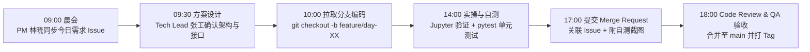

# 星辰数科研发团队 GitLab 协作规范（模拟实战版）

在实际企业级 AI 应用开发中，写代码只占 40% 的时间，另外 60% 是**需求对齐、架构评审、分支协作、测试验证与上线发布**。本规范贯穿 70 天全部迭代。

---

## 1. 分支管理模型（GitLab Flow 精简版）

- `main`：生产主干分支，永远保持可部署状态。每次迭代完成并通过 QA 测试后，由 Tech Lead 合并并打上版本 Tag（如 `v0.1.0-day01`）。
- `develop`：日常集成分支。
- `feature/day-XX-<模块名>`：每日开发特性分支。例如：`feature/day-01-user-profile`、`feature/day-02-prompt-sanitizer`。

## 2. Commit Message 规范（Conventional Commits 中文团队版）

格式：`<type>(<scope>): <subject>`

- `feat`: 新增业务功能（例如：`feat(day-02): 新增 Prompt 文本清洗与敏感词脱敏模块`）
- `fix`: 修复 Bug（例如：`fix(day-05): 修复嵌套 JSON 解析空字段报错问题`）
- `docs`: 文档更新（PRD、架构图、课件、README）
- `test`: 补充或修改 pytest 单元测试
- `refactor`: 代码重构（不改变外部行为，例如 Day 06 函数式重构）
- `chore`: 环境配置、依赖更新、CI 脚本

## 3. 每日研发标准流（SOP）

## 4. Merge Request (MR) 自查清单

1. 代码是否符合 PEP 8 规范，关键逻辑是否有中文注释与 Docstring？
2. 是否包含 `pytest` 单元测试，且本地执行 100% 通过？
3. 是否泄露了 API Key、数据库密码等敏感信息？（严禁硬编码密钥）
4. Jupyter Notebook 是否已从头到尾重新运行（Restart & Run All）且无报错？
