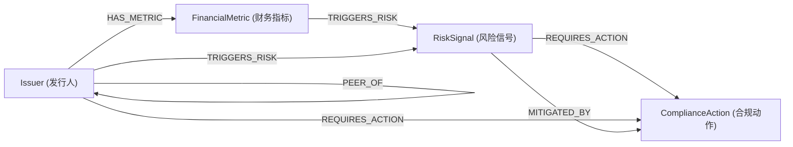

# 02 规划阶段：WBS、风险登记册、Mermaid 本体图与 LLM Wiki 设计

## 1. 工作分解结构 (WBS)

- **1.0 领域本体层 (`app/ontology.py`)**
  - 1.1 定义 `Issuer`、`FinancialMetric`、`RiskSignal`、`ComplianceAction`、`OntologyLink` 模型
  - 1.2 实现 `OntologyRegistry`：Schema 校验、BFS 图谱遍历、动作前置条件检查
- **2.0 LLM Wiki 引擎 (`app/llm_wiki.py`)**
  - 2.1 `index.md`、`log.md`、`entities/<id>.md` 持久化读写
  - 2.2 `ingest()`、`query()`、`lint()`（孤立页、断链、指标冲突、过期条目检测）
- **3.0 FDE 生产流水线 (`app/fde_pipeline.py`)**
  - 3.1 财务比率计算工具（`debt_to_equity`、`current_ratio`、`interest_coverage`、`roe`）
  - 3.2 PII 脱敏与 MNPI 合规护栏
  - 3.3 HITL 审批队列与 JSONL 审计日志 (`audit_trail.jsonl`)
- **4.0 API 服务与部署 (`app/api.py`, `Dockerfile`, `docker-compose.yml`)**
  - 4.1 FastAPI 路由、`X-Request-ID` 中间件、结构化异常处理
  - 4.2 多阶段非 root Docker 构建与健康检查

---

## 2. 风险登记册 (Risk Register)

| 风险 ID | 风险描述 | 概率 | 影响 | 缓解措施 |
| --- | --- | --- | --- | --- |
| R-01 | 多份研报同一周期财务指标数值冲突 | 高 | 高 | `FinTechLLMWiki.lint()` 自动对比同周期观测值并报告 `conflicting_metrics` |
| R-02 | 查询输入泄露手机号/身份证/银行卡等 PII | 中 | 高 | `scan_guardrails()` 在入库和查询前执行正则脱敏 |
| R-03 | 未授权角色审批高危合规动作 | 低 | 极高 | `check_action_preconditions()` 强制校验角色与最低风险等级 |
| R-04 | 知识库实体孤立或链接失效 | 中 | 中 | `lint()` 检测 `orphan_pages` 与 `broken_links` |

---

## 3. 金融领域本体图 (Mermaid Ontology Graph)



---

## 4. LLM Wiki 存储设计

```text
wiki/
├── index.md              # 全局实体索引表（含 [[entity_id]] 链接）
├── log.md                # 追加式操作日志（INGEST / LINT 时间戳）
└── entities/
    ├── issuer_acme.md    # 实体页：YAML 前置元数据 + 指标表 + 观测历史 + [[wiki_links]]
    └── issuer_beta.md
```
