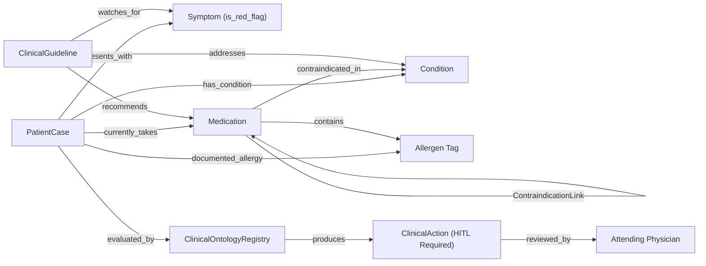

# 02 — Planning: WBS & Clinical Ontology Architecture

## 1. Work Breakdown Structure (WBS)
- **1.0 Initiating & Governance**: Charter, HIPAA Safe Harbor checklist, HITL policy.
- **2.0 Clinical Ontology (`app/ontology.py`)**:
  - 2.1 Core Pydantic v2 entities (`PatientCase`, `Symptom`, `Medication`, `ClinicalGuideline`, `ContraindicationLink`, `ClinicalAction`).
  - 2.2 `ClinicalOntologyRegistry` with drug-drug interaction, allergy cross-reactivity, and condition contraindication checks.
- **3.0 Clinical LLM Wiki (`app/llm_wiki.py`)**:
  - 3.1 Markdown persistence (`index.md`, `log.md`, `entities/<id>.md` with `[[wiki_links]]`).
  - 3.2 Deterministic `ingest()`, keyword-scored `query()`, and `lint()` consistency auditor.
- **4.0 FDE Safety Pipeline (`app/fde_pipeline.py`)**:
  - 4.1 PHI/HIPAA de-identification (`deidentify_phi`).
  - 4.2 Red-flag emergency triage escalation & vital-sign threshold rules.
  - 4.3 Drug-interaction guardrail, HITL physician sign-off, and JSONL audit trail.
- **5.0 Production API & Deployment (`app/api.py`, `Dockerfile`, `docker-compose.yml`)**:
  - 5.1 FastAPI endpoints, `X-Request-ID` middleware, `/health`, `/ready`, `/metrics`.
  - 5.2 Multi-stage non-root container & Compose stack.
- **6.0 Verification & Closing (`tests/`, `docs/pmp/`)**:
  - 6.1 Pytest integration & unit suite.
  - 6.2 QA report, handover checklist, and incident runbook.

## 2. Clinical Ontology Diagram (Mermaid)

## 3. Schedule & Risk Register
| Risk | Likelihood | Impact | Mitigation |
| --- | --- | --- | --- |
| Conflicting dosage guidelines in Wiki | Medium | High | `ClinicalLLMWiki.lint()` flags differing `dose_mg` per `(condition, medication)` |
| PHI leakage into audit logs | Low | Critical | `deidentify_phi()` runs before triage storage and HITL note persistence |
| Contraindicated medication proposed | Medium | Critical | `ClinicalOntologyRegistry` sets `blocked=True` and action status `blocked` |
