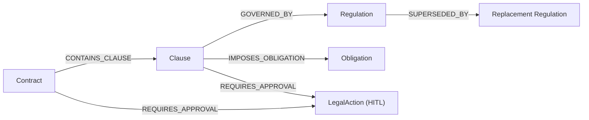

# 02 Planning: WBS & Legal Ontology Design

## 1. Work Breakdown Structure (WBS)
- **1.0 Ontology Core (`app/ontology.py`)**
  - 1.1 Entity schemas (`Contract`, `Clause`, `Regulation`, `Obligation`, `LegalLink`, `LegalAction`)
  - 1.2 Deterministic risk classifier & liability cap extractor
  - 1.3 Regulation keyword & statutory mapping
- **2.0 Legal LLM Wiki (`app/llm_wiki.py`)**
  - 2.1 Markdown persistence (`index.md`, `log.md`, `entities/<id>.md`)
  - 2.2 `ingest()` & TF-style `query()` with `[[wiki_links]]`
  - 2.3 `lint()` checks (superseded regulations, unlinked clauses, conflicting liability caps)
- **3.0 FDE Pipeline & API (`app/fde_pipeline.py`, `app/api.py`)**
  - 3.1 PII & account masking
  - 3.2 Clause extraction, obligation parsing & redline suggestions
  - 3.3 HITL General Counsel approval & audit trail
  - 3.4 FastAPI endpoints & `X-Request-ID` middleware
- **4.0 Packaging, Docs & QA**
  - 4.1 Multi-stage non-root `Dockerfile` & `docker-compose.yml`
  - 4.2 PMP 0-to-1 documentation
  - 4.3 Automated `pytest` verification

## 2. Legal Ontology Diagram

## 3. Risk Classification Matrix
| Risk Level | Score Range | Trigger Examples | HITL Required |
| :--- | :--- | :--- | :--- |
| `critical` | `>= 0.85` | Unlimited/uncapped liability, waive GDPR/PIPL | Yes (GC) |
| `high` | `0.70 - 0.84` | Sell personal data, legacy `95/46/EC`, no-notice termination | Yes (GC) |
| `medium` | `0.45 - 0.69` | Auto-renewal, 90-day payment, broad indemnity | Optional |
| `low` | `< 0.45` | Standard NDA, governing law, mutual terms | No |
