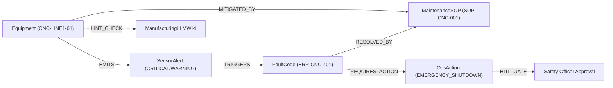

# 02. Planning: WBS & Manufacturing Ontology

## 1. Work Breakdown Structure (WBS)
- **1.0 Ontology Modeling (`app/ontology.py`)**
  - 1.1 Define Pydantic domain entities (`Equipment`, `SensorAlert`, `FaultCode`, `MaintenanceSOP`, `OpsLink`, `OpsAction`).
  - 1.2 Implement `ManufacturingOntologyRegistry` with deterministic `check_telemetry()` and `resolve_fault_to_sop()`.
- **2.0 Knowledge Graph Wiki (`app/llm_wiki.py`)**
  - 2.1 Persist `index.md`, `log.md`, and `entities/<id>.md` with `[[wiki_links]]`.
  - 2.2 Implement `ingest()`, `query()`, and `lint()` (unmapped fault codes, outdated SOPs, orphan equipment).
- **3.0 FDE Pipeline & HITL Gate (`app/fde_pipeline.py`)**
  - 3.1 Sensor anomaly diagnosis + Wiki/Ontology SOP retrieval.
  - 3.2 `EMERGENCY_SHUTDOWN` HITL safety-officer gate & audit trail.
- **4.0 Production API & Deployment (`app/api.py`, `Dockerfile`)**
  - 4.1 FastAPI endpoints, `X-Request-ID` middleware, `/health`, `/ready`, `/metrics`.
  - 4.2 Multi-stage non-root Docker build & `docker-compose.yml`.

## 2. Manufacturing Ontology Diagram

