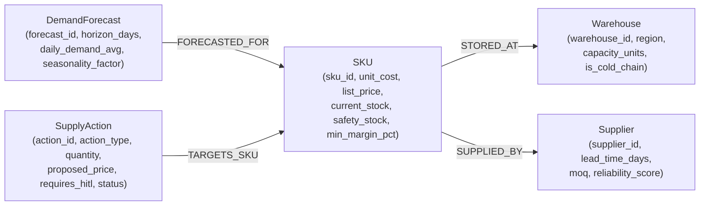

# 02. 项目规划：WBS 工作分解与零售供应链本体架构

## 1. 工作分解结构（WBS）
- **1.0 启动阶段**：商业论证、KPI 设定、干系人对齐。
- **2.0 本体与知识库规划**：定义 `SKU`、`Warehouse`、`Supplier`、`DemandForecast`、`SupplyLink`、`SupplyAction` 强类型模型；设计 `RetailLLMWiki`（`index.md` / `log.md` / `entities/*.md`）。
- **3.0 FDE 核心管线开发**：需求异常检测、Wiki+Ontology 联合补货推理、毛利护栏、HITL 门禁、审计日志。
- **4.0 生产化与容器交付**：FastAPI 接口、`X-Request-ID` 中间件、`/health` `/ready` `/metrics`、多阶段非 root Dockerfile。
- **5.0 测试与收尾移交**：Pytest 自动化门禁、运维 Runbook 移交。

## 2. 零售供应链领域本体图谱（Mermaid Ontology）

## 3. LLM Wiki 活体知识库结构
- `wiki/index.md`：全量实体目录、类型与双向链接索引。
- `wiki/log.md`：不可变追加日志，记录每次 `INGEST`、`LINT`、`ACTION` 与 `HITL` 决策。
- `wiki/entities/<entity_id>.md`：单实体百科词条，维护 `[[wiki_links]]`、事实规则与来源溯源。

## 4. 风险登记册（Risk Register）
| 风险项 | 影响 | 缓解策略 |
| :--- | :--- | :--- |
| 促销规则冲突导致负毛利 | 高 | `lint()` 扫描冲突折扣 + `evaluate_margin_guardrail()` 硬拦截 |
| 供应商交期波动引发断货 | 高 | `check_safety_stock()` 实时对比 `days_of_supply < lead_time_days` |
| 大额 PO 误触发自动下单 | 高 | `requires_hitl` 强制进入 `PENDING_APPROVAL` 等待买手审批 |
