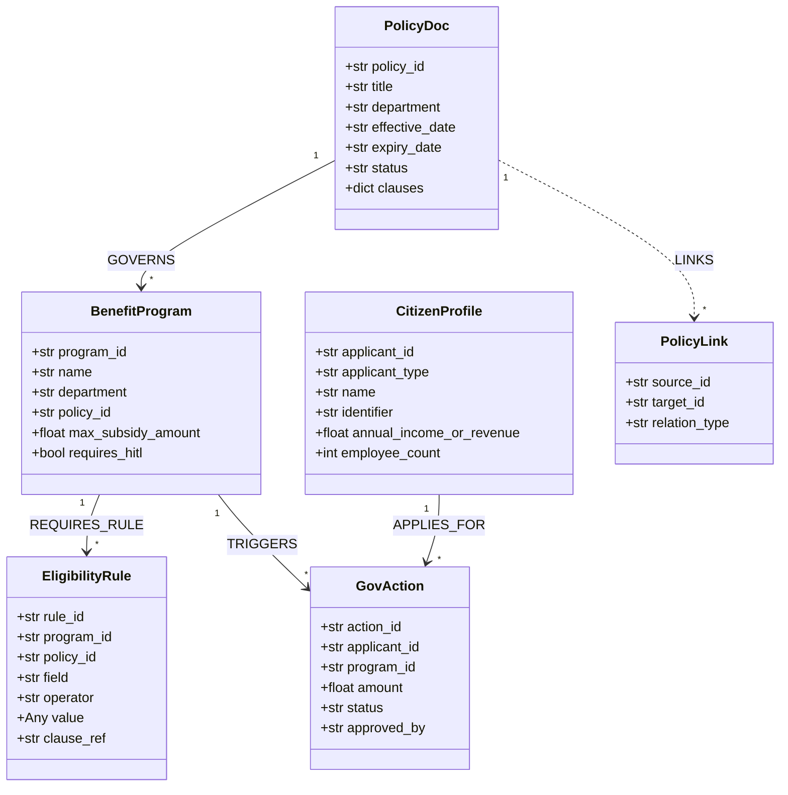

# 02. 规划：WBS 工作分解与政务本体设计 (Planning: WBS & GovTech Ontology)

## 1. WBS 工作分解结构
- **1.0 政务本体建模 (`app/ontology.py`)**
  - 1.1 定义 `PolicyDoc`、`CitizenProfile`、`BenefitProgram`、`EligibilityRule`、`PolicyLink`、`GovAction`
  - 1.2 实现 `GovOntologyRegistry` 多规则评估引擎与部门路由表
- **2.0 政策知识库 (`app/llm_wiki.py`)**
  - 2.1 持久化 Markdown 目录结构（`index.md`、`log.md`、`entities/<id>.md`）与 `[[wiki_links]]`
  - 2.2 实现 `ingest()`、`query()` 与 `lint()`（过期政策、补贴阈值冲突、孤立规则/悬空链接检测）
- **3.0 FDE 合规推理流水线 (`app/fde_pipeline.py`)**
  - 3.1 公民与企业 PII 自动脱敏（身份证、USCC、手机号、银行卡、邮箱）
  - 3.2 条款级引用、无依据拒答、HITL 审批流与审计日志
- **4.0 生产 API 与容器化 (`app/api.py`, `Dockerfile`, `docker-compose.yml`)**
  - 4.1 `/health`、`/ready`、`/metrics` 与 `X-Request-ID` 中间件
  - 4.2 `/api/v1/wiki/*`、`/api/v1/ontology/eligibility`、`/api/v1/policy/ask`、`/api/v1/actions/approve`
- **5.0 质量保障与交付验收 (`tests/test_p06_govtech.py`)**

## 2. GovTech 本体关系图 (Mermaid Ontology Diagram)

