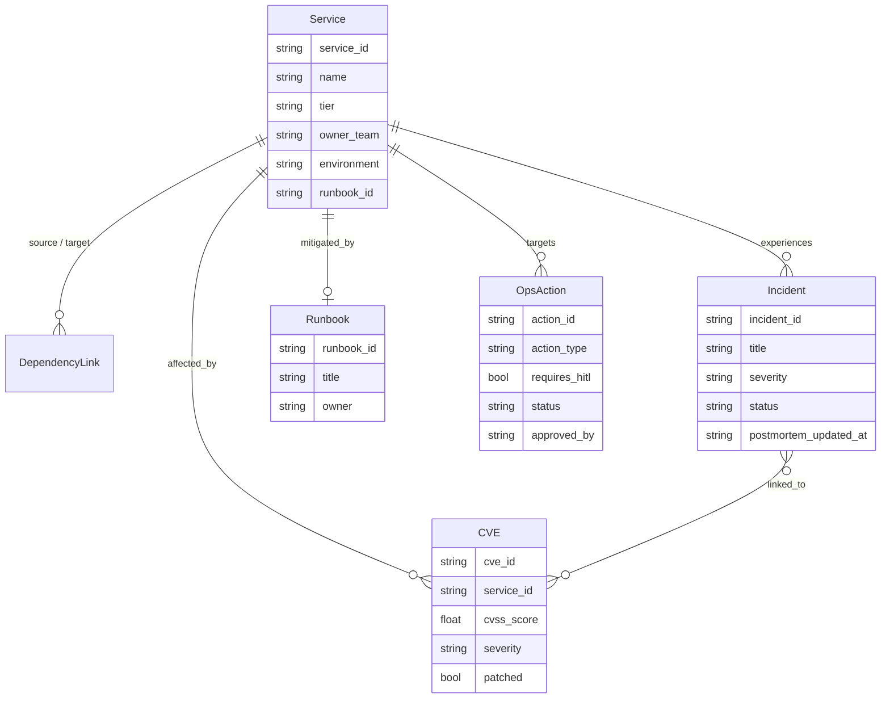

# 02 - Planning: WBS & DevSecOps Ontology

## 1. Work Breakdown Structure (WBS)
- **1.0 Ontology & Graph Engine (`app/ontology.py`)**
  - 1.1 Entity definitions (`Service`, `CVE`, `Incident`, `Runbook`, `DependencyLink`, `OpsAction`)
  - 1.2 Reverse-dependency BFS blast-radius traversal
  - 1.3 CVSS severity gating (`CRITICAL >= 9.0 -> BLOCK_DEPLOY`)
- **2.0 Persistent LLM Wiki (`app/llm_wiki.py`)**
  - 2.1 `index.md` catalog, `log.md` append-only audit log, `entities/<id>.md` with `[[wiki_links]]`
  - 2.2 Deterministic keyword `query()`
  - 2.3 `lint()` detector (missing runbooks, unpatched critical CVEs, stale postmortems, broken links)
- **3.0 FDE Triage & HITL Pipeline (`app/fde_pipeline.py`)**
  - 3.1 Secret/token redaction guardrail (`sk-`, `ghp_`, `AKIA`, `Bearer`, `password=`)
  - 3.2 Root-cause & blast-radius correlation
  - 3.3 HITL approval gate for production `rollback`/`quarantine` + immutable audit trail
- **4.0 Production API & Containerization (`app/api.py`, `Dockerfile`)**
  - 4.1 FastAPI endpoints + `X-Request-ID` middleware + `/health`, `/ready`, `/metrics`
  - 4.2 Multi-stage non-root `Dockerfile` + `docker-compose.yml`

## 2. DevSecOps Ontology Diagram

